# Modded Dhalmels for FFXI

Pick a mod. Take its folder. Put it in Pivot. Turn it on. Done.

The game's own files are never touched. Only you see the mod.

---

## Mod #1: Cow

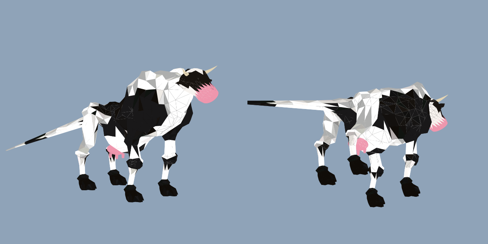

| you use | take this folder |
|---|---|
| no HD mods | [`retail/DhalmelCow`](retail/DhalmelCow) |
| NextHD (or any HD mod) | [`nexthd/DhalmelCow-HD`](nexthd/DhalmelCow-HD) |

## Mod #2: Neck


| you use | take this folder |
|---|---|
| no HD mods | [`retail/DhalmelShaft`](retail/DhalmelShaft) |
| NextHD (or any HD mod) | [`nexthd/DhalmelShaft-HD`](nexthd/DhalmelShaft-HD) |

## Mod #3: Centurion set HD (Hume male)

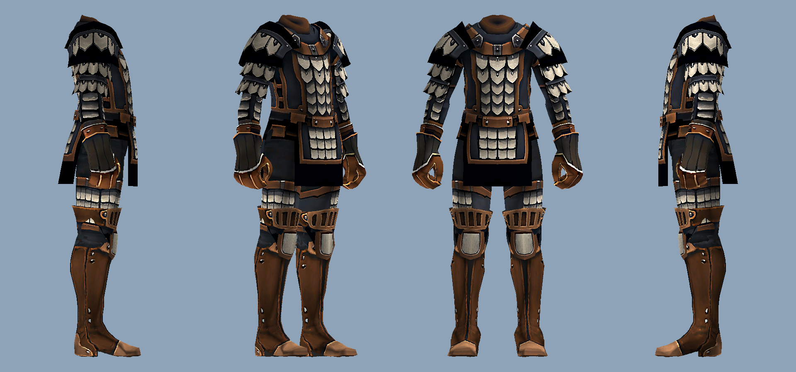

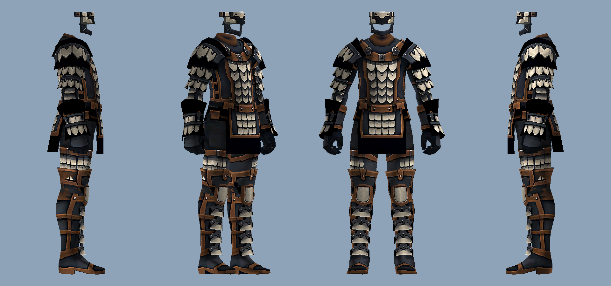

| you use | take this folder |
|---|---|
| Hume male | [`retail/CenturionHD-HumeM`](retail/CenturionHD-HumeM) |

The original look, sharper. Smoother geometry (16x the triangles, real curves, seams
still closed) and 4x textures on one shared palette for the whole Centurion set (visor,
scale mail, gauntlets, cuisses, greaves, sword, axe) plus Battle Gloves and Bounding Boots.

## Mod #4: Centurion Set, Bastok Pride (Hume male)

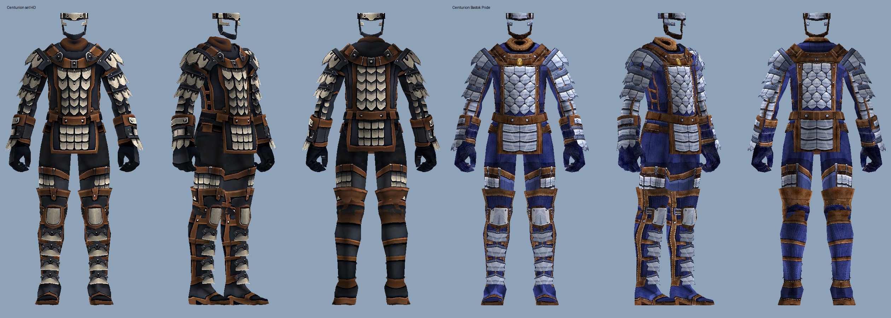

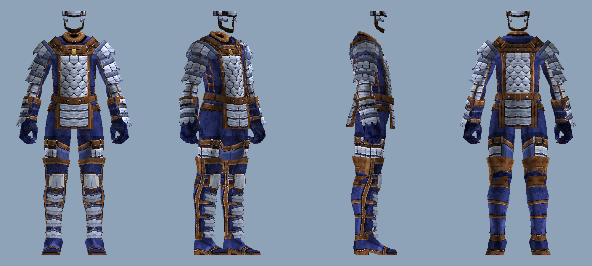

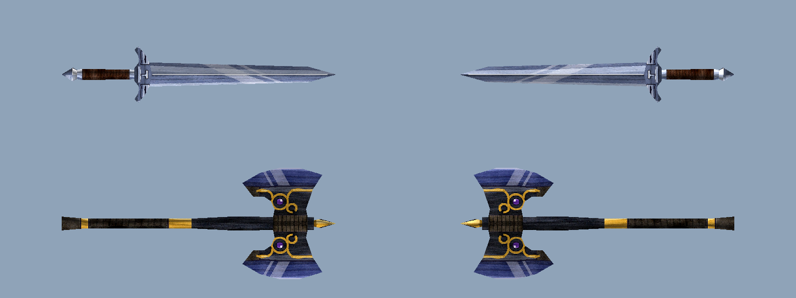

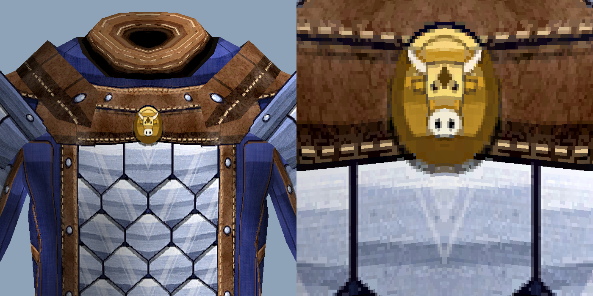

| you use | take this folder |
|---|---|
| Hume male | [`retail/CenturionBastokPride-HumeM`](retail/CenturionBastokPride-HumeM) |

The whole Centurion set painted new in bright Bastok colours: indigo cloth from neck to
shoes, stacked steel plating that really overlaps, brushed and scratched metal, stitched
leather in the HD set's cooler browns, indigo gauntlet gloves, and a brass cow emblem on
the chest. Visor, scale mail, gauntlets, cuisses, greaves, sword and axe.

## Mod #5: Bounding Boots HD (Hume male)

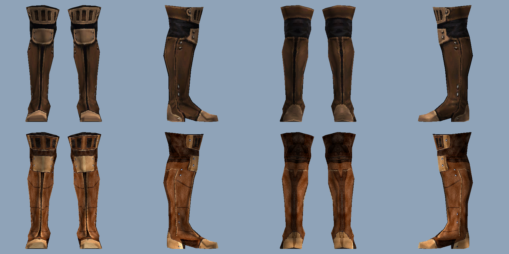

| you use | take this folder |
|---|---|
| Hume male | [`retail/BoundingBootsHD-HumeM`](retail/BoundingBootsHD-HumeM) |

Painted new: saddle leather shaft, tan toe cap, heel and knee tab, steel ladder buckle,
dark leather wrap, stitching and rivets. Leather only, no blue.

## Mod #6: Battle Gloves HD (Hume male)

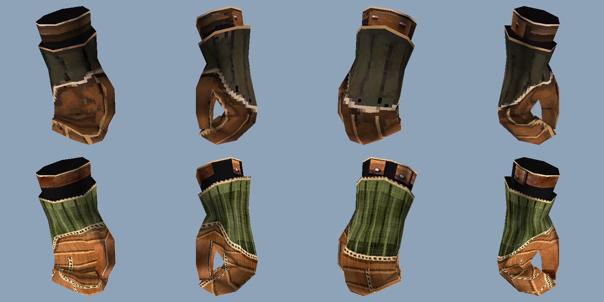

| you use | take this folder |
|---|---|
| Hume male | [`retail/BattleGlovesHD-HumeM`](retail/BattleGlovesHD-HumeM) |

Painted new: brown wrapped canvas hands with stitched finger seams, olive quilted cuff
bound with light piping. Cloth only, no blue.

### Wearing them together

Bastok Pride with the Bounding Boots and Battle Gloves is the BLU outfit:

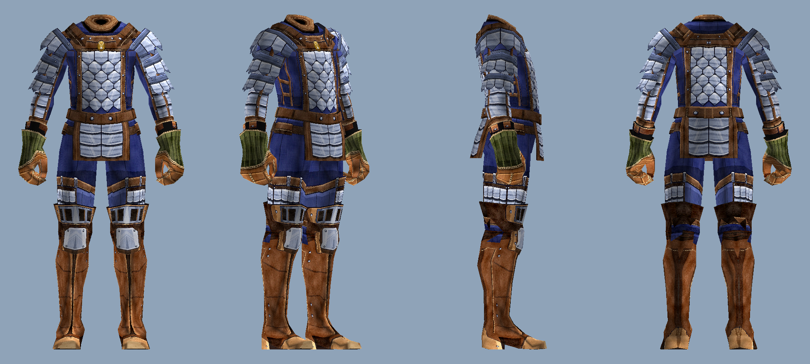

Mods 4, 5 and 6 don't share any files: turn on all three. Mod 3 shares files with all of
them: whichever is higher in `/pivot` wins.

**Mods 3 to 6 are Hume male only** and use this install's ROM paths, so they only line up
on a client whose VTABLE maps these items the same way (Phoenix does).

## Mod #7: Bastok Pride, Bounding Boots HD, Battle Gloves HD for every race

Mods 4, 5 and 6 for all eight races (Taru male and female share their gear files).
Each folder holds every race at once; the game only loads the files your race uses.

| mod | take this folder |
|---|---|
| Centurion Set, Bastok Pride | [`retail/CenturionBastokPride-AllRaces`](retail/CenturionBastokPride-AllRaces) |
| Bounding Boots HD | [`retail/BoundingBootsHD-AllRaces`](retail/BoundingBootsHD-AllRaces) |
| Battle Gloves HD | [`retail/BattleGlovesHD-AllRaces`](retail/BattleGlovesHD-AllRaces) |

Use these instead of the `-HumeM` folders (they include Hume male). Where a race's
texture layout matches Hume male's (Hume F, Elvaan, Mithra, Galka) it gets the
hand-painted design; parts laid out differently (the Taru layout, Galka's thigh guards,
the Mithra tail) get the same colours from the automatic pass. The original alpha values
are kept as stored (Taru gear marks solid texels as 119/136, not 255). Mithra tails stay plain
leather, no armour.

**Hume male**
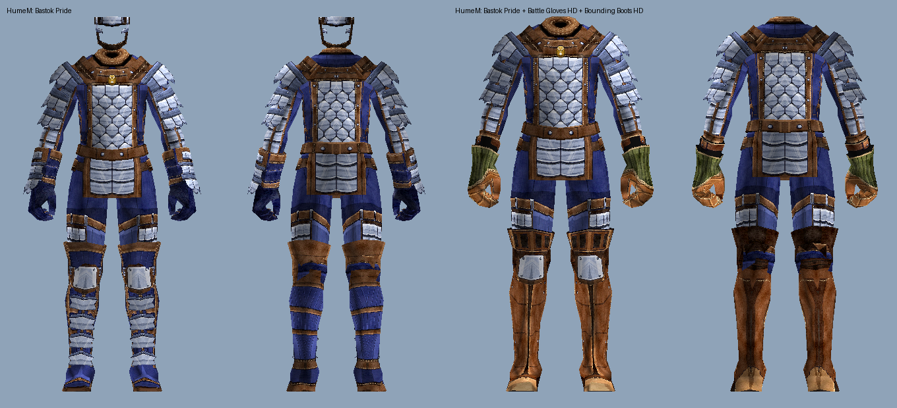

**Hume female**
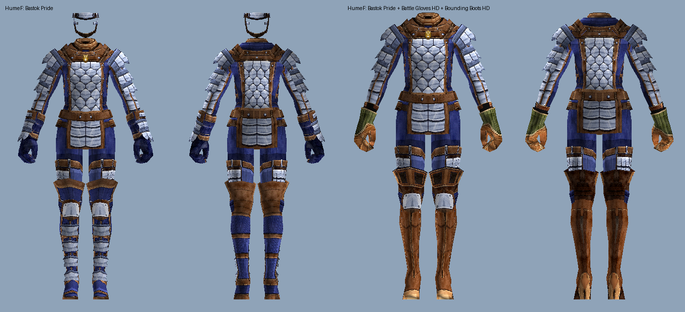

**Elvaan male**
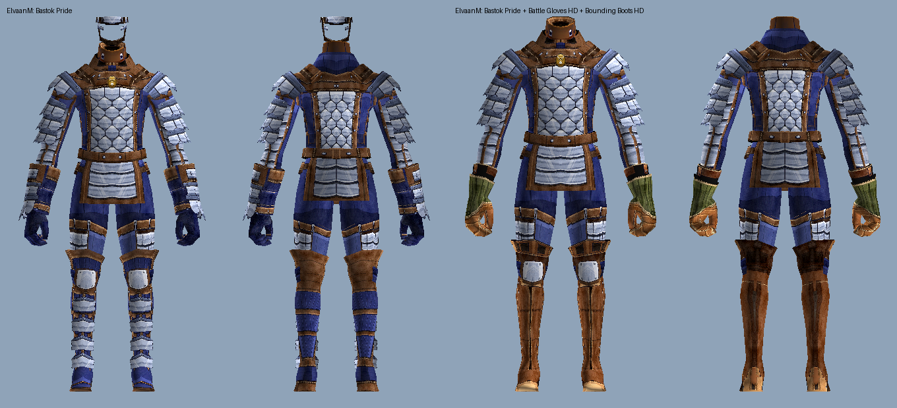

**Elvaan female**


**Tarutaru (male and female)**
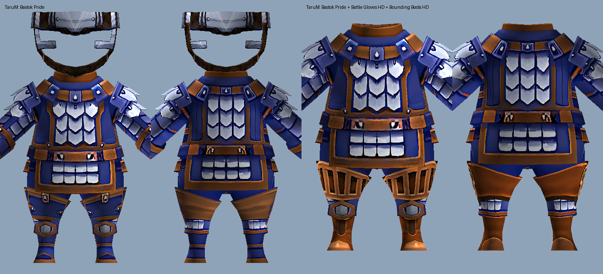

**Mithra**


**Galka**
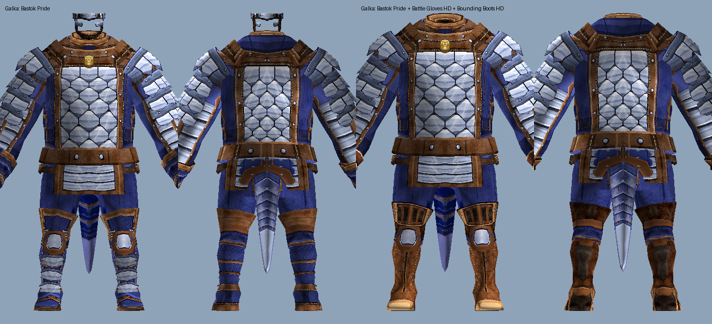

---

## Install

1. Copy the folder into your Pivot `DATs` folder. It sits next to `NextHD`, `XiView` and
   the rest. You end up with, for example:

   ```
   <your DATs folder>\DhalmelCow-HD\ROM\5\15.DAT
   ```

2. In game type `/pivot`, click **+** on the mod, and **drag it to the top of the list**.

3. Restart the game.

That's it.

**Why the top?** Pivot uses the first folder in the list that has the file. If NextHD is
above your mod, you see NextHD's Dhalmel. Mod on top, you see the mod.

**Want the other mod instead?** Put both in. Whichever is higher wins. Drag to swap.

**Turn it off:** uncheck it in `/pivot`, or delete the folder. Nothing else to undo.

---

## Which file do I take?

The HD mods give you NextHD's sharper textures. The retail mods give you the plain game
textures. Same cow, same neck, same animations. Only the texture resolution differs.

Take the HD one if you run any HD DAT pack. Take the retail one if you don't.
Wrong pick costs you nothing but sharpness.

---

## Build your own

[`ffxi_modder`](https://github.com/cowrevenge/ffxi_modder) makes these from any Dhalmel DAT.
The output always goes in its own folder, never into NextHD's.

```powershell
git clone https://github.com/cowrevenge/ffxi_modder
cd ffxi_modder
cargo run --release -- "<your>\ROM\5\15.DAT" --check                          # must say byte-identical
cargo run --release -- "<your>\ROM\5\15.DAT" out.DAT                          # neck
cargo run --release --bin dhalmel_cow -- "<your>\ROM\5\15.DAT" out.DAT        # cow
```

Feed it your retail `ROM\5\15.DAT` for a retail build, or NextHD's copy for an HD build.
Run `--check` first: if the writer can't reproduce your file byte for byte, don't trust a
mod built from it.

A rebuild won't be bit-identical to the files here (compiler float noise, invisible in game).
The files in this repo are the ones that were rendered and checked. Prefer them.

`ROM\5\15.DAT` is where the Dhalmel lives on this install (model 332, DAT id 1632). Your
install can map it elsewhere: see `ffxi_modder`'s README to resolve it.

---

## Files

Every DAT and its hash is in [`SHA256SUMS.txt`](SHA256SUMS.txt).

| | |
|---|---|
| retail mods | [`retail/`](retail) |
| HD mods | [`nexthd/`](nexthd) |
| untouched originals, both bases | [`original/`](original) |
| what's winning in your Pivot | `tools\verify-pivot.ps1 -DatPath ROM\5\15.DAT` |

```powershell
Get-FileHash -Algorithm SHA256 .\retail\DhalmelCow\ROM\5\15.DAT
```

---

## Legal

Everything here derives from Square Enix retail game data: the mods are that model with
sections swapped, the originals are unaltered. Shared in the same spirit as the HD DAT
overlays that already circulate in the FFXI community. The tooling is GPL-3.0 and lives in
[`ffxi_modder`](https://github.com/cowrevenge/ffxi_modder), which contains no game data.
