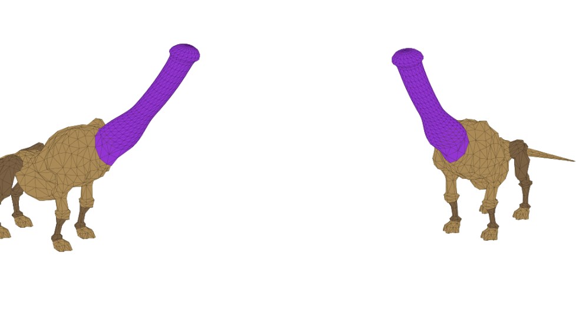

# ffxi_mod_files

Client-side FFXI DAT mods. Each mod is a self-contained folder that drops into a
[XIPivot](https://github.com/HealsCodes/XIPivot) overlay root, so nothing is ever written to
the game files and only machines that install a mod see it.

This repo is the **mod list**. The tooling that produces these files is separate:
[`ffxi_modder`](https://github.com/cowrevenge/ffxi_modder), a GPL-3.0 lossless DAT
reader/writer.


---

## Mod list

| mod | target | status | overlay folder | file |
|---|---|---|---|---|
| **Galka Neck** | Galka neck | shipped | `DhalmelShaft` | `ROM/5/15.DAT` |
| **Dhalmel Cow** | Dhalmel -> cow | in progress | - | - |

Everything under `overlay/` mirrors Pivot's overlay root one-to-one: copy the contents of
`overlay/` into your `DATs` folder and every shipped mod lands in the right place. Adding a
mod means adding a sibling folder, not restructuring anything.

## Installing

**Requires XIPivot** -- confirm it loads with `/pivot` in game.

1. Find Pivot's overlay root by reading `root_path` from Pivot's config. Do not guess it.
   Under Ashita it is usually `polplugins/DATs`, and existing overlays sit directly inside it.
2. Copy the mod's folder from `overlay/` into that root, keeping its `ROM\...` path intact.
3. Enable the mod and put it **above any overlay that ships the same DAT path**.
4. Restart the client. Pivot resolves DATs at load, so a reload is not enough.

### The ordering trap

Pivot's rule is *the lowest-numbered overlay holding the file wins*. HD texture and model
packs routinely carry their own copy of the same DAT -- NextHD ships a 776,896-byte
high-poly Dhalmel at `ROM/5/15.DAT`, for instance. If your mod sorts below one of those you
see no change and reasonably assume it is broken.

`tools/verify-pivot.ps1` resolves the config the way Pivot does, prints which overlays
contain the file, names the winner, and exits non-zero if anything is shadowing the mod:

```powershell
powershell -File tools\verify-pivot.ps1
```

### Uninstalling

Delete the mod's folder from the overlay root and restart. Nothing else to revert -- the
game files are never touched.

---

## Dhalmel Shaft

*Shipped.* Replaces every Dhalmel's head and neck with one procedural purple shaft. It rises
from the shoulder seam along the neck's own centerline, weighted entirely onto the neck and
head bones, so it bends with the neck and nods with the head like the geometry it replaced.

**Install:** copy `overlay/DhalmelShaft` to `<overlay root>\DhalmelShaft`, then restart.



The added mesh in its rest pose, before lighting and animation. Use this rather than a
screenshot to judge shape -- shaft profile, flared base, tip curve -- and to check intended
colour, since it is unlit and shows the texture's raw `#9A2BD8`.

### How it works

The head is identified from the skeleton, not by guessing which mesh section it is:

| | |
|---|---|
| **head** | joint 36, the skeleton's look-at reference -- the bone retail bends to aim the face -- plus its 9 descendants (ears etc.) |
| **neck** | the parent chain from the head down to the first joint that branches |
| **shoulders** | joint 29, that branching parent, which also carries the front legs |

273 head and neck triangles are removed, 10 neck-base triangles retextured in place to close
the seam, and 265 vertices / 494 triangles added in 4 draws. Every added vertex is weighted
100% onto the neck and head joints and mirrored on Z the way the head was -- which is why the
shaft animates correctly for free, bound to the bones the head used.

Colour is a new 16x16 DXT3 solid-purple texture chunk appended to the DAT rather than a
`t_factor` tint. Its header is copied from a retail texture so fields whose meaning is
unknown keep plausible values.

Shipped shape: shaft length 3.692, shaft radius 0.260, base radius 0.434, 24 rings.

### Files and integrity

| file | bytes | SHA-256 |
|---|---|---|
| `overlay/DhalmelShaft/ROM/5/15.DAT` | 501,024 | `86f9a5b7c83614b49c3e7a71dd93e0143e157a2fd4b53c5c12ec46d6ff561ad3` |
| `original/ROM/5/15.DAT` | 481,984 | `6283bb7dff849da0e0eb20f04d529c2e1f2effeaf7b52be301301913540f42ec` |

`original/` is the untouched retail model the mod was built from -- included so you can
confirm what changed, and so the mod can be rebuilt from a known-good base without your
install having to match mine.

```powershell
Get-FileHash -Algorithm SHA256 overlay\DhalmelShaft\ROM\5\15.DAT
```

### Rebuild it yourself

The committed DAT is not required -- generate it from a retail file you already own:

```powershell
git clone https://github.com/cowrevenge/ffxi_modder
cd ffxi_modder
cargo run --release -- "<your FFXI>\ROM\5\15.DAT" out.DAT
```

Prove the writer is trustworthy on your file first; an unedited parse and write must come
back byte-identical:

```powershell
cargo run --release -- "<your FFXI>\ROM\5\15.DAT" --check
```

Shape is tunable via the `const`s at the top of `src/main.rs` -- `PURPLE`,
`SHAFT_RADIUS_SCALE`, `TIP_PER_HEAD_LENGTH`, `SEAM_OVERLAP`, `GLANS`, and the rest.

Two honesty notes:

- **Rebuilds are not bit-identical to the committed file.** Re-running the tool reproduces
  the model exactly but leaves 1,708 bytes different -- 1,337 float lanes, maximum absolute
  delta 3.97e-05 on a model about 3.7 units tall. Compiler floating-point noise in the
  normalised vertices, invisible in game. Want *this* file? Download it. Changed a `const`?
  Rebuild.
- **`ROM\5\15.DAT` is not a universal path.** It is this install's mapping. See
  [Finding a model's DAT file](#finding-a-models-dat-file).

## Dhalmel Cow

*In progress.* Rebuild the Dhalmel along the cow reference below. Not shipped yet -- the
model, skeleton and target sections still have to be worked out the same way the neck mod
was, then the geometry produced with `ffxi_modder`.


## Finding a model's DAT file

The route used for every mod here, worked out from data rather than trial and error:

1. **model id** -- LandSandBoat `data/zones/*/mobs.yaml`, reading the entries that share a
   species and skill list. (Common mobs moved out of `mob_pools.sql` into per-zone YAML.)
2. **DAT file id** -- `npc_dat_id()`: `model < 1500` gives `model + 1300`; `< 3000` gives
   `+ 50295`; `< 3500` gives `+ 96907`; otherwise `+ 98239`.
3. **ROM path** -- the highest ROM whose VTABLE byte equals its own index owns the file, then
   `dir = entry >> 7` and `file = entry & 0x7F`.

For the Dhalmel that chain is model **332** -> file id **1632** -> `ROM\5\15.DAT` on this
install. Step 3 is install-specific, so resolve it against your own DATs.

## Legal

Every DAT here derives from Square Enix retail game data. A modded file is the retail model
with mesh sections swapped; the originals are those same files unaltered, kept for
reproducibility. Published in the same spirit as the HD DAT overlays that already circulate
freely in the FFXI community.

For the tooling alone, use [`ffxi_modder`](https://github.com/cowrevenge/ffxi_modder) --
separate repo, GPL-3.0, and contains no game data.
