# Modded Dhalmels for FFXI

Pick a mod. Take its folder. Put it in Pivot. Turn it on. Done.

The game's own files are never touched. Only you see the mod.

---

## Mod #1: Cow


| you use | take this folder |
|---|---|
| no HD mods | [`retail/DhalmelCow`](retail/DhalmelCow) |
| NextHD (or any HD mod) | [`nexthd/DhalmelCow-HD`](nexthd/DhalmelCow-HD) |

## Mod #2: Neck


| you use | take this folder |
|---|---|
| no HD mods | [`retail/DhalmelShaft`](retail/DhalmelShaft) |
| NextHD (or any HD mod) | [`nexthd/DhalmelShaft-HD`](nexthd/DhalmelShaft-HD) |

## Mod #3: Centurion set HD (Hume male)


| you use | take this folder |
|---|---|
| Hume male | [`retail/CenturionHD-HumeM`](retail/CenturionHD-HumeM) |

The original look, sharper. Smoother geometry (16x the triangles, real curves, seams
still closed) and 4x textures on one shared palette for the whole Centurion set (visor,
scale mail, gauntlets, cuisses, greaves, sword, axe) plus Battle Gloves and Bounding Boots.

## Mod #4: Centurion Set, Bastok Pride (Hume male)


| you use | take this folder |
|---|---|
| Hume male | [`retail/CenturionBastokPride-HumeM`](retail/CenturionBastokPride-HumeM) |

The whole Centurion set painted new in bright Bastok colours: indigo cloth from neck to
shoes, stacked steel plating that really overlaps, brushed and scratched metal, stitched
leather in the HD set's cooler browns, indigo gauntlet gloves, and a brass cow emblem on
the chest. Visor, scale mail, gauntlets, cuisses, greaves, sword and axe.

## Mod #5: Bounding Boots HD (Hume male)


| you use | take this folder |
|---|---|
| Hume male | [`retail/BoundingBootsHD-HumeM`](retail/BoundingBootsHD-HumeM) |

Painted new: saddle leather shaft, tan toe cap, heel and knee tab, steel ladder buckle,
dark leather wrap, stitching and rivets. Leather only, no blue.

## Mod #6: Battle Gloves HD (Hume male)


| you use | take this folder |
|---|---|
| Hume male | [`retail/BattleGlovesHD-HumeM`](retail/BattleGlovesHD-HumeM) |

Painted new: brown wrapped canvas hands with stitched finger seams, olive quilted cuff
bound with light piping. Cloth only, no blue.

### Wearing them together

Bastok Pride with the Bounding Boots and Battle Gloves is the BLU outfit:

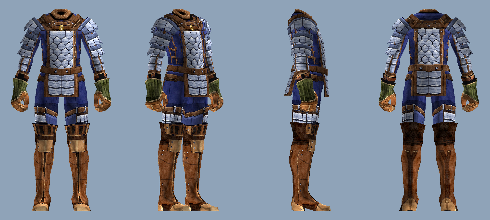

Mods 4, 5 and 6 don't share any files: turn on all three. Mod 3 shares files with all of
them: whichever is higher in `/pivot` wins.

**Mods 3 to 6 are Hume male only** and use this install's ROM paths, so they only line up
on a client whose VTABLE maps these items the same way (Phoenix does).

## Mod #7: Bastok Pride, Bounding Boots HD, Battle Gloves HD for every race

Mods 4, 5 and 6 for all eight races (Taru male and female share their gear files).
Each folder holds every race at once; the game only loads the files your race uses.

| mod | take this folder |
|---|---|
| Centurion Set, Bastok Pride | [`retail/CenturionBastokPride-AllRaces`](retail/CenturionBastokPride-AllRaces) |
| Bounding Boots HD | [`retail/BoundingBootsHD-AllRaces`](retail/BoundingBootsHD-AllRaces) |
| Battle Gloves HD | [`retail/BattleGlovesHD-AllRaces`](retail/BattleGlovesHD-AllRaces) |

Use these instead of the `-HumeM` folders (they include Hume male). Where a race's
texture layout matches Hume male's (Hume F, Elvaan, Mithra, Galka) it gets the
hand-painted design; parts laid out differently (Galka's thigh guards, the Mithra tail, the rest of the Taru
set) get the same colours from the automatic pass. The Taru cuisses, greaves and Bounding
Boots are hand-painted on the Taru layout:

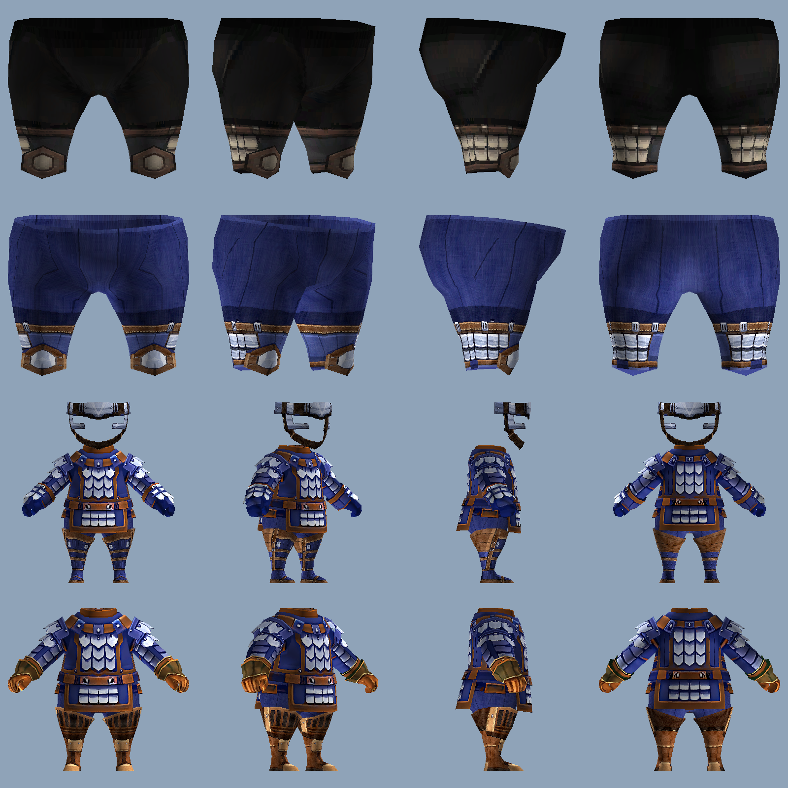

 Hume F, Elvaan F and Mithra
get the same stacked chest scales, lit by their own model's curve so the bust reads round:

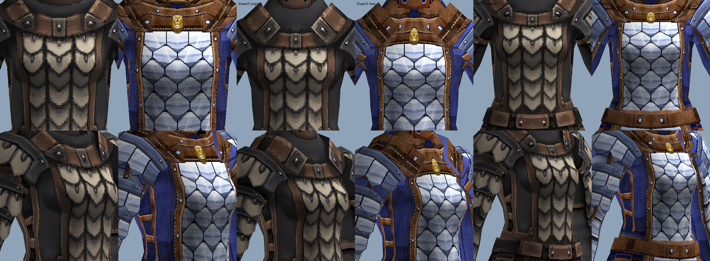

 The original alpha values
are kept as stored (Taru gear marks solid texels as 119/136, not 255). Mithra tails stay plain
leather, no armour.

**Hume male**
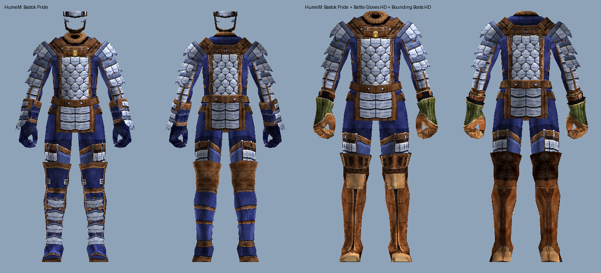

**Hume female**
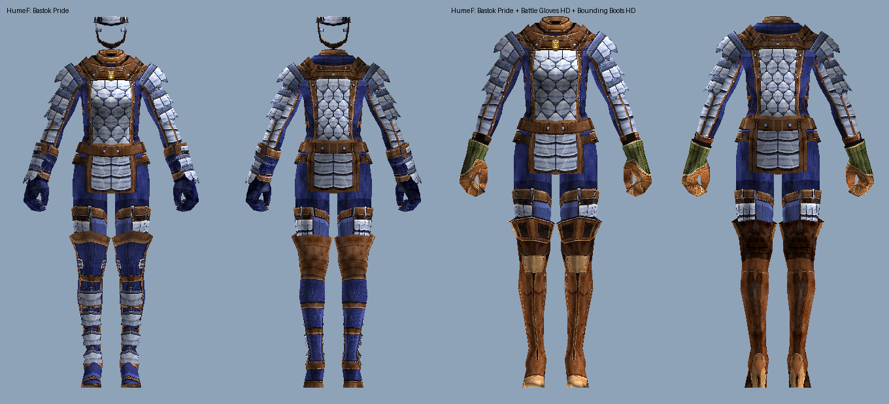

**Elvaan male**
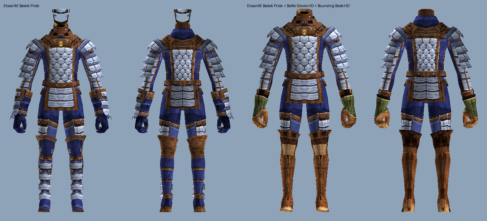

**Elvaan female**
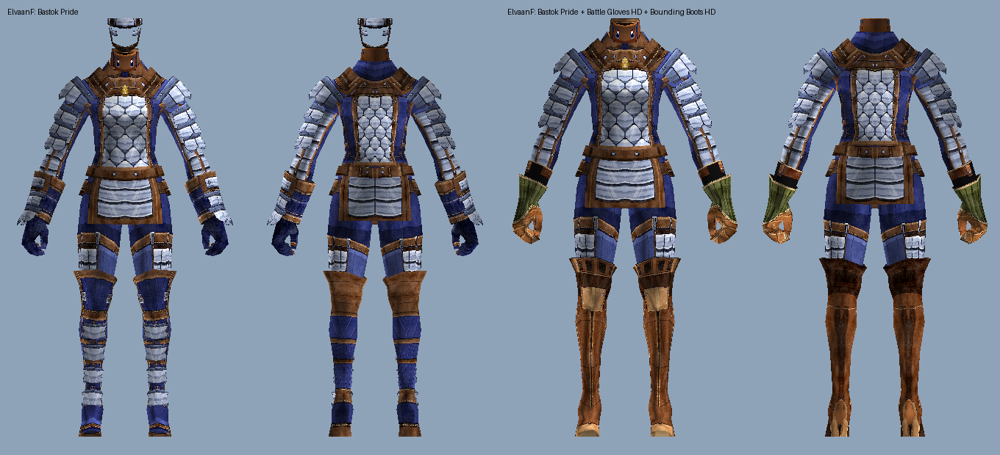

**Tarutaru (male and female)**


**Mithra**
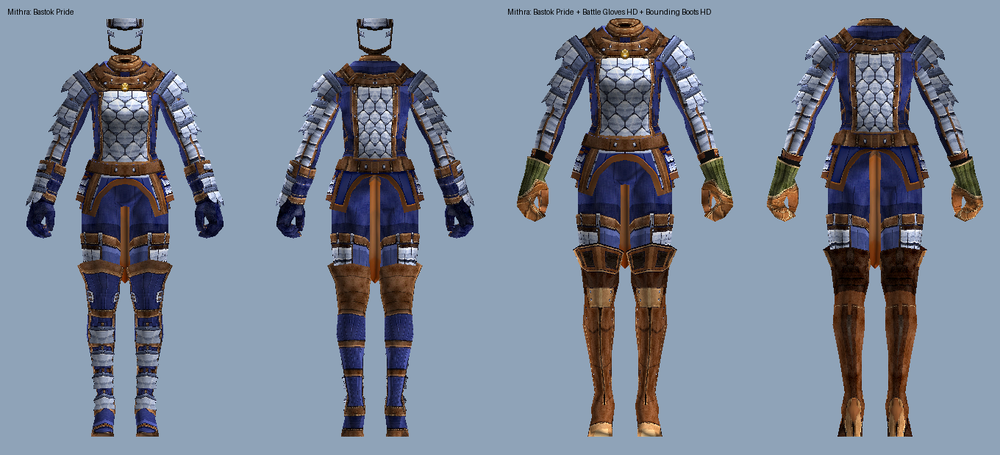

**Galka**
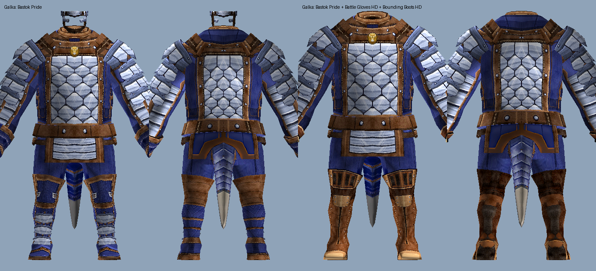

## Mod #8: Auto HD sets (Hume male)

The automatic HD pass: every item keeps its own design and colours, cleaned up the
way the Centurion HD set was (crisper lines, brighter and cleaner colour per material,
light leather grain and brushed steel), 4x textures, cut-outs kept. This is the pass
that will run over all gear; these are its test sets.

| set | take this folder |
|---|---|
| Seer's (cloth) | [`retail/AutoHD-Seers-HumeM`](retail/AutoHD-Seers-HumeM) |
| Bone | [`retail/AutoHD-Bone-HumeM`](retail/AutoHD-Bone-HumeM) |
| Lizard | [`retail/AutoHD-Lizard-HumeM`](retail/AutoHD-Lizard-HumeM) |
| Scale (lv10) | [`retail/AutoHD-Scale-HumeM`](retail/AutoHD-Scale-HumeM) |
| Leather (lv7) | [`retail/AutoHD-Leather-HumeM`](retail/AutoHD-Leather-HumeM) |

Lizard Ledelsens use the same file as the Bounding Boots, so the Lizard folder carries the
Bounding Boots HD file for the feet.

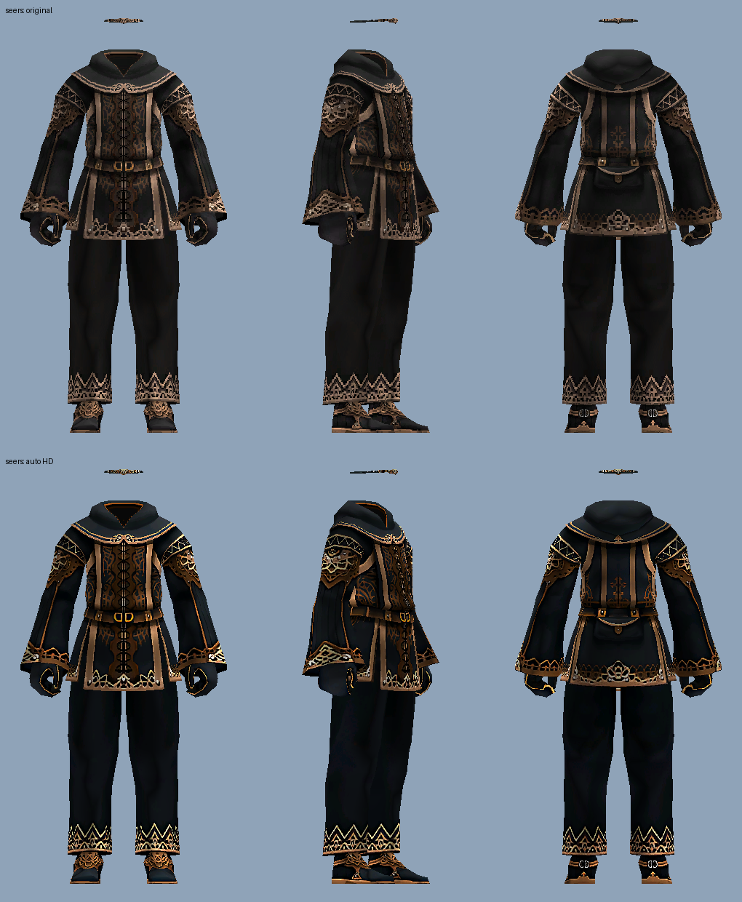
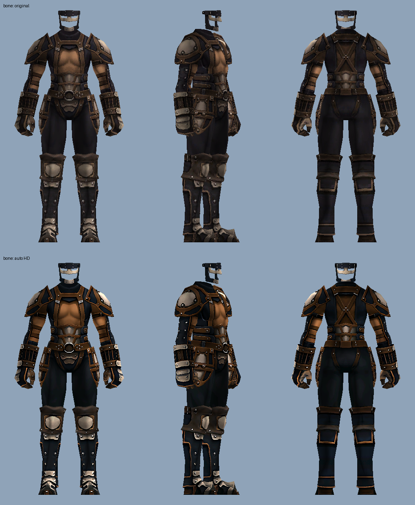
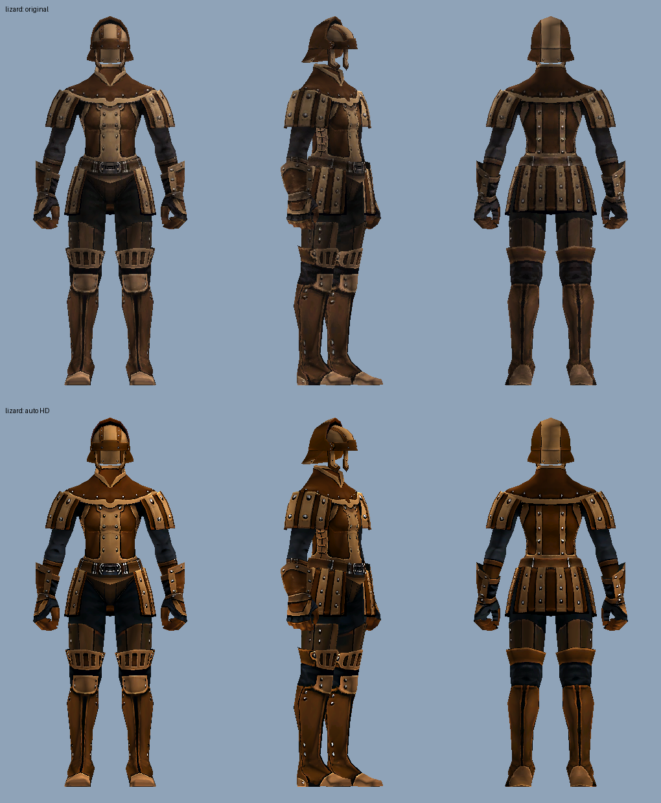
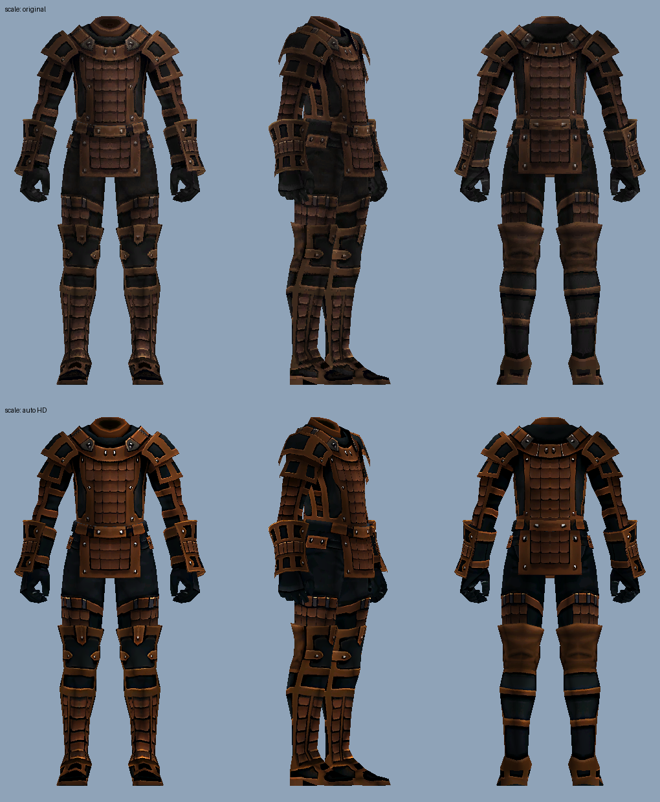
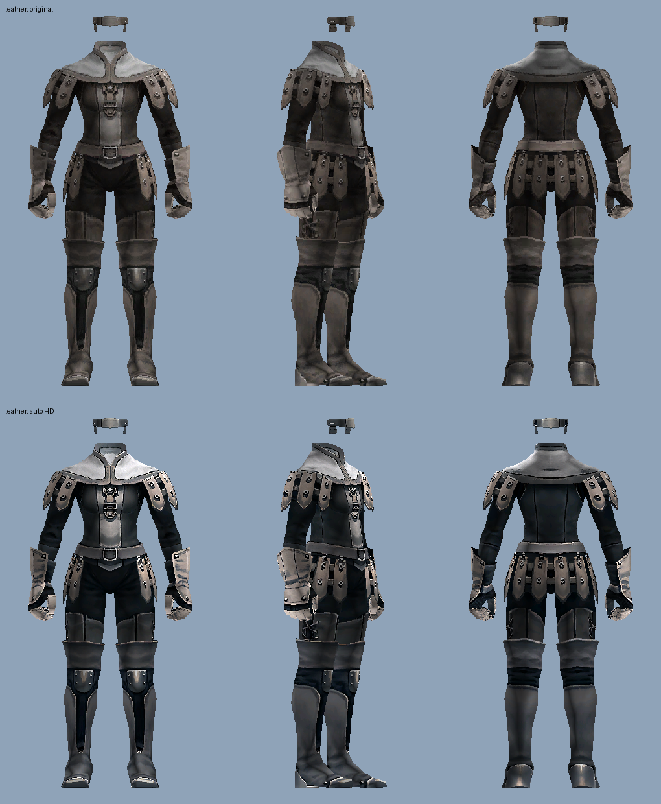

## Mod #9: Eisen / Kampf, polished (Hume male)

The auto HD pass plus a hand-tuned finish on the steel: deeper engraving cuts, a
polished highlight curve and a cool silver tone. The dark padded suit and brown leather
stay as they are. Eisen and Kampf share the same files, so this covers both.

| you use | take this folder |
|---|---|
| Hume male | [`retail/EisenKampfPolished-HumeM`](retail/EisenKampfPolished-HumeM) |

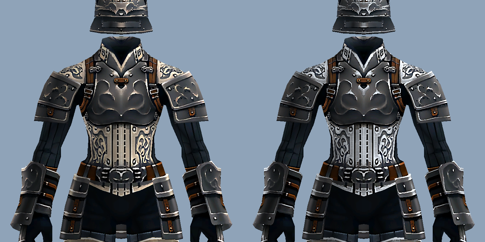

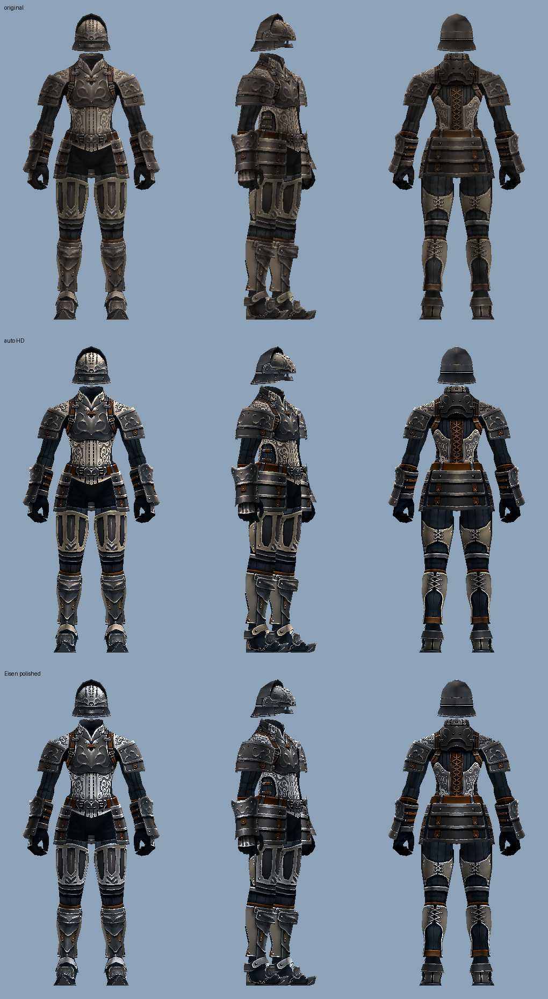

## Mod #10: Bastok Pride, fuller bust (Hume F, Elvaan F, Mithra)

The Bastok Pride chest with a fuller bust. Vertices are added around the bust (the
low-poly chest gets about 2.5x the vertices there, re-skinned so they animate), the shape
is hand-tuned per race, and the scale shading is re-baked from the new shape. The neck,
arms, waist and back seams do not move, so it fits with every other piece.

| you use | take this folder |
|---|---|
| Hume F, Elvaan F, Mithra | [`retail/BastokPrideBusty-FemaleRaces`](retail/BastokPrideBusty-FemaleRaces) |

Put it **above** `CenturionBastokPride-AllRaces` in `/pivot`: it replaces only the
three female chest files.

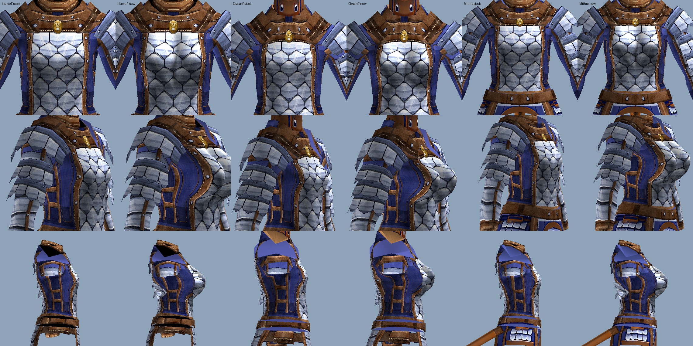

## Mod #11: Test sets with a fuller bust (Hume F, Elvaan F, Mithra)

The chest pieces of the six test sets for the female races: the auto HD texture (the
polished finish for Eisen/Kampf), the same hand-tuned bust shape as Mod #10 with added
vertices, and the shading re-baked from the new shape. **Chest pieces only.**

| set | take this folder |
|---|---|
| Seer's tunic | [`retail/Busty-Seers-FemaleRaces`](retail/Busty-Seers-FemaleRaces) |
| Eisen/Kampfbrust, polished | [`retail/Busty-EisenKampfPolished-FemaleRaces`](retail/Busty-EisenKampfPolished-FemaleRaces) |
| Bone harness | [`retail/Busty-Bone-FemaleRaces`](retail/Busty-Bone-FemaleRaces) |
| Lizard jerkin | [`retail/Busty-Lizard-FemaleRaces`](retail/Busty-Lizard-FemaleRaces) |
| Scale mail | [`retail/Busty-Scale-FemaleRaces`](retail/Busty-Scale-FemaleRaces) |
| Leather vest | [`retail/Busty-Leather-FemaleRaces`](retail/Busty-Leather-FemaleRaces) |

Hume male's Lizard set (Mod #8) now includes its feet: Lizard Ledelsens use the same file
as the Bounding Boots, so the folder carries the Bounding Boots HD file.

**Seer's tunic**
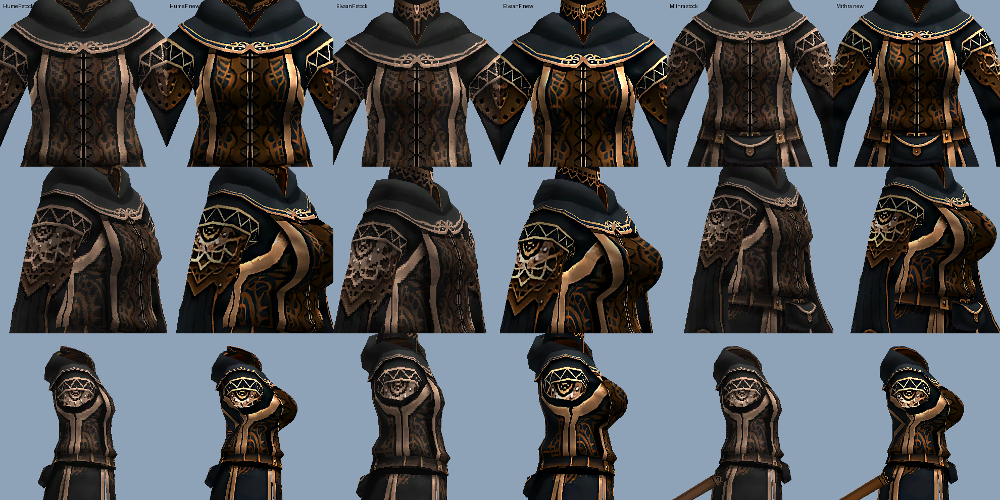

**Eisen/Kampfbrust, polished**
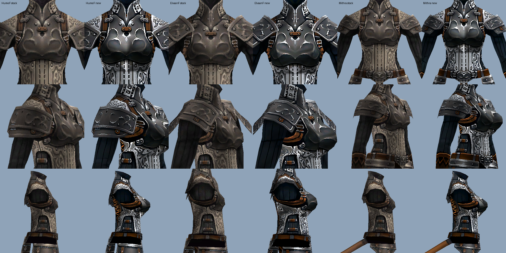

**Bone harness**
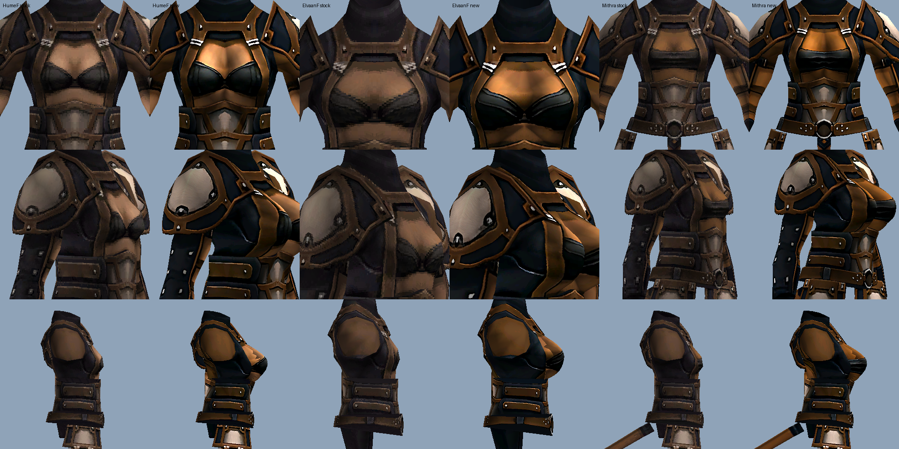

**Lizard jerkin**
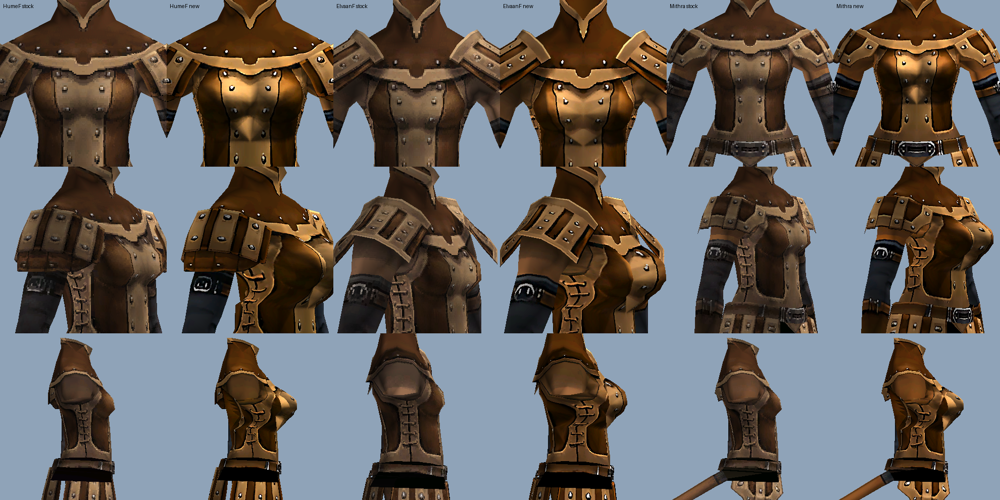

**Scale mail**
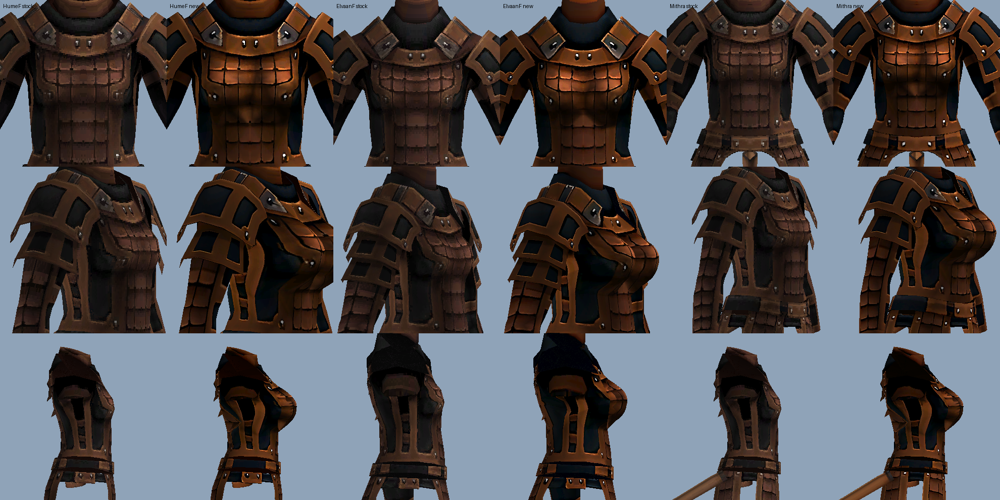

**Leather vest**
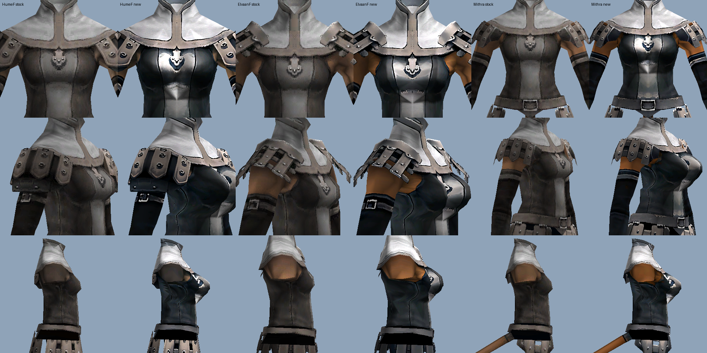

## Mod #12: The test sets, whole, for every race

Mods 8, 9 and 11 together for all eight races (Taru male and female share their gear
files): every piece of each set gets the automatic HD pass (Eisen/Kampf gets the polished
finish), the Hume F, Elvaan F and Mithra chests are the fuller-bust ones from Mod #11, and
Lizard Ledelsens are the Bounding Boots HD file for each race. Mithra and Galka tails keep
their natural look. Each folder holds every race at once; the game only loads the files
your race uses.

| set | take this folder |
|---|---|
| Seer's (cloth) | [`retail/AutoHD-Seers-AllRaces`](retail/AutoHD-Seers-AllRaces) |
| Eisen/Kampf, polished | [`retail/EisenKampfPolished-AllRaces`](retail/EisenKampfPolished-AllRaces) |
| Bone | [`retail/AutoHD-Bone-AllRaces`](retail/AutoHD-Bone-AllRaces) |
| Lizard | [`retail/AutoHD-Lizard-AllRaces`](retail/AutoHD-Lizard-AllRaces) |
| Scale (lv10) | [`retail/AutoHD-Scale-AllRaces`](retail/AutoHD-Scale-AllRaces) |
| Leather (lv7) | [`retail/AutoHD-Leather-AllRaces`](retail/AutoHD-Leather-AllRaces) |

Use these instead of the `-HumeM` and `Busty-` folders of Mods 8, 9 and 11: they hold the
same files plus every other race. Original on top, new below.

Update: bare skin painted into the gear (Hume F, Elvaan F and Mithra thighs and midriffs,
Galka shins) keeps its natural colour instead of turning orange; Mods 13 and 14 got the same
fix. Scale Mail's front plates (chest and lower panel) are redrawn: straight lines, square
stacked plates and a clean centre line where the two mirrored halves meet (Hume, Elvaan,
Mithra, Galka; Taru's layout never had the problem).

**Seer's**
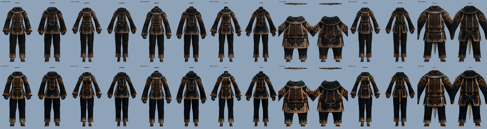

**Eisen/Kampf, polished**
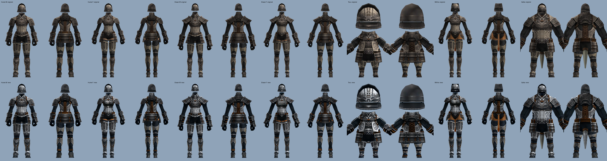

**Bone**
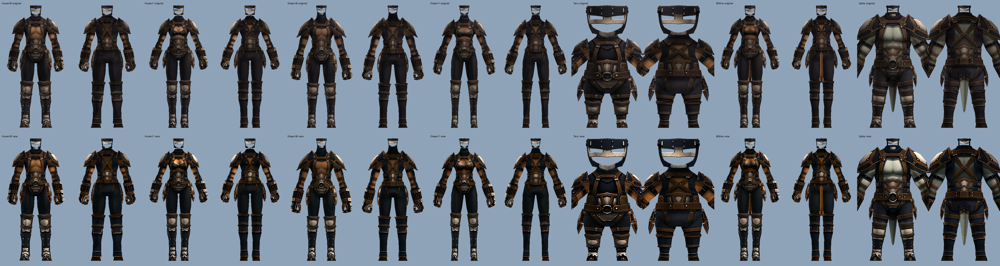

**Lizard**
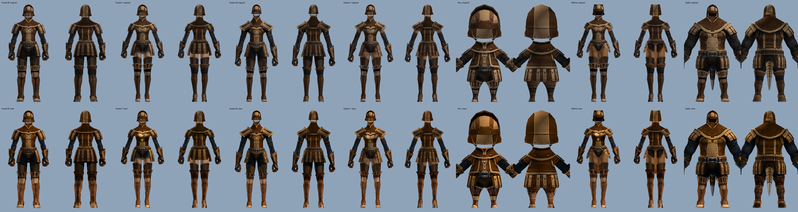

**Scale**
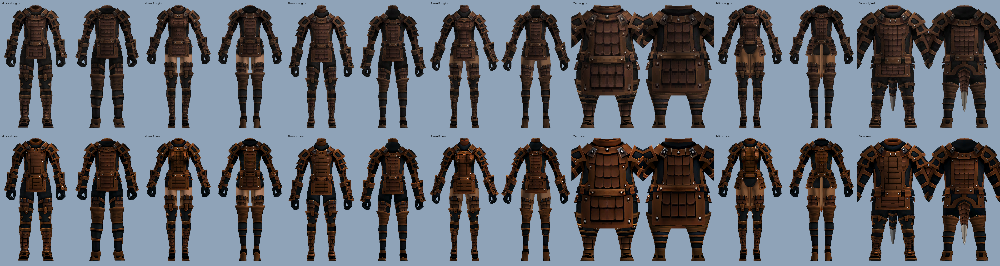

**Leather**
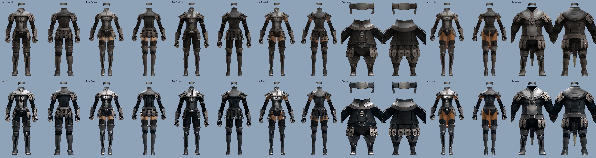

## Mod #13: Royal Squire's set, every race

The automatic HD pass on the whole Royal Squire's set (helm, chainmail, mufflers,
breeches, sollerets) for all eight races, with the fuller-bust chest for Hume F, Elvaan F
and Mithra. These files are the shared look, so Banded Mail, Kingdom, San d'Orian, Iron
Ram, Breeches, Mufflers and Sollerets get it too.

| set | take this folder |
|---|---|
| Royal Squire's | [`retail/AutoHD-RoyalSquire-AllRaces`](retail/AutoHD-RoyalSquire-AllRaces) |

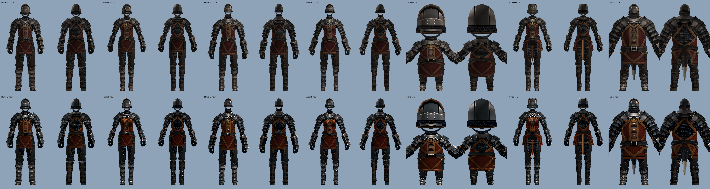

## Mod #14: Mercenary Captain's set and Doublet, every race

The automatic HD pass on Mercenary Captain's headgear, doublet, hose and gaiters for all
eight races, with the fuller-bust chest for Hume F, Elvaan F and Mithra. Doublet uses the
same files, and so do the Cotton, Linen, Wool, Great, Federation and Windurstian doublets,
headgear, brais and gaiters. The gloves are left out: they are the Battle Gloves file, which
Mod #7 already covers hand-painted.

| set | take this folder |
|---|---|
| Mercenary Captain's / Doublet | [`retail/AutoHD-MercCaptain-AllRaces`](retail/AutoHD-MercCaptain-AllRaces) |

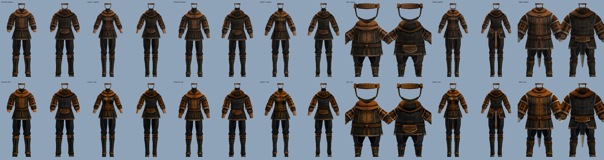

## Mod #15: Artifact armour (all 22 jobs) and RSE, every race

The automatic HD pass on every job's artifact armour (head, body, hands, legs, feet) and on
both looks of the race-specific sets (lv1, which the lv62 gloves and boots share, and lv27-33:
Custom, Magna, Elder's, Savage, Wonder), for all eight races. Female chests get the
fuller bust. The +1 versions use the same files. Dancer's has a male and a female look;
each race gets its own.

Bare skin painted into the gear (thighs, midriffs, arms) now keeps its natural colour: the
pass finds each race's own skin tone in smooth areas and leaves it out of the leather boost
(Hume F, Elvaan F, Mithra, Galka). The bust shading on the chest now changes lightness only.

| set | take this folder |
|---|---|
| Artifact armour, all jobs | [`retail/AutoHD-AF-AllRaces`](retail/AutoHD-AF-AllRaces) |
| Race-specific equipment | [`retail/AutoHD-RSE-AllRaces`](retail/AutoHD-RSE-AllRaces) |

Original on top, new below.

**Warrior (Fighter's)**
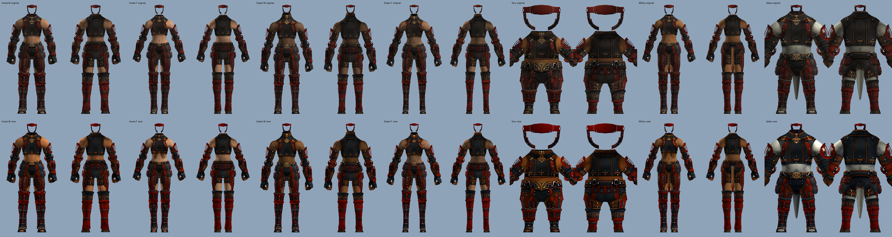

**Monk (Temple)**
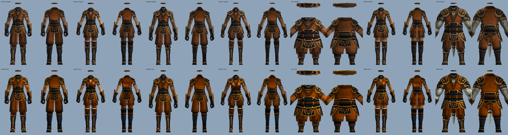

**White Mage (Healer's)**
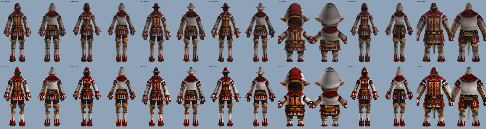

**Black Mage (Wizard's)**
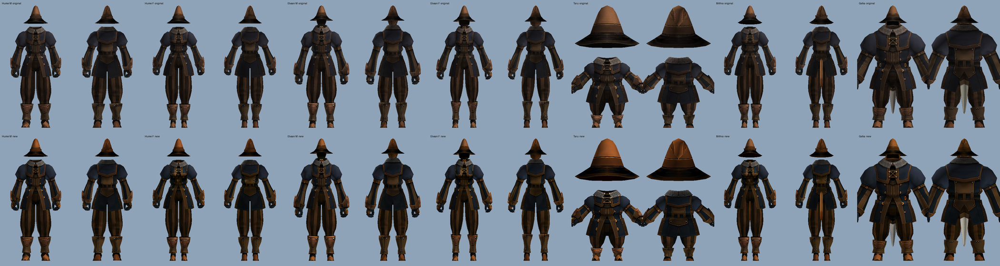

**Red Mage (Warlock's)**
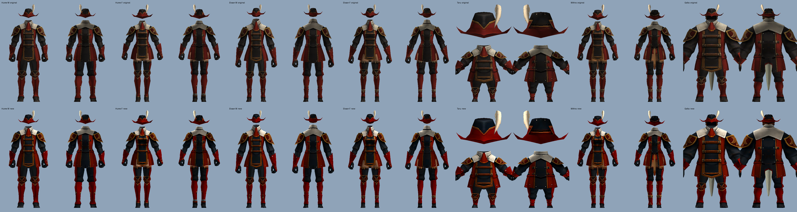

**Thief (Rogue's)**
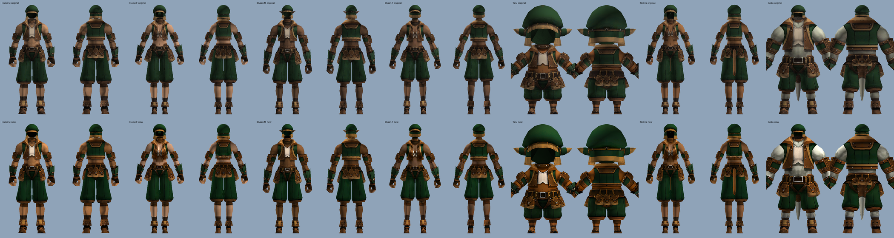

**Paladin (Gallant)**
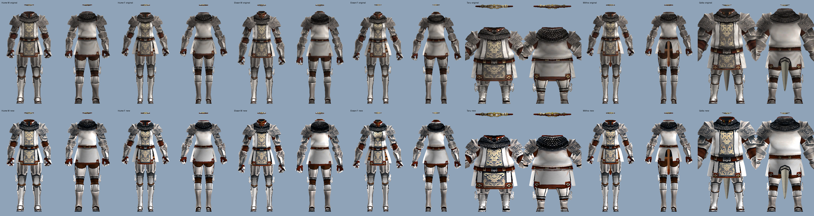

**Dark Knight (Chaos)**
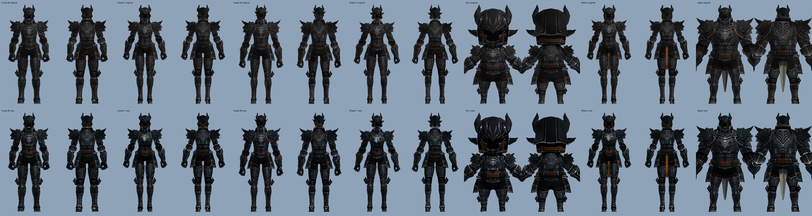

**Beastmaster (Beast)**
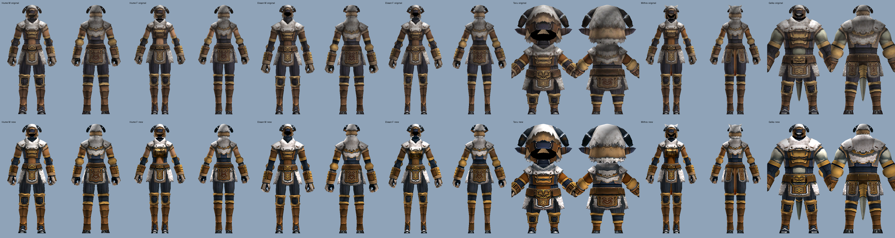

**Bard (Choral)**
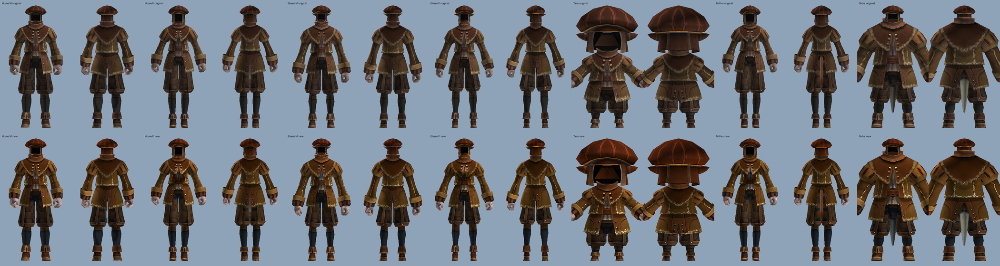

**Ranger (Hunter's)**
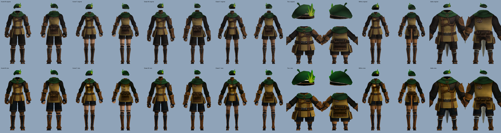

**Samurai (Myochin)**
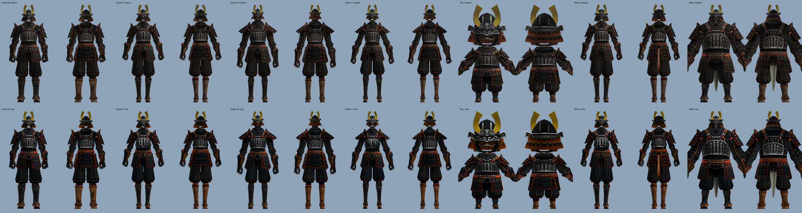

**Ninja**
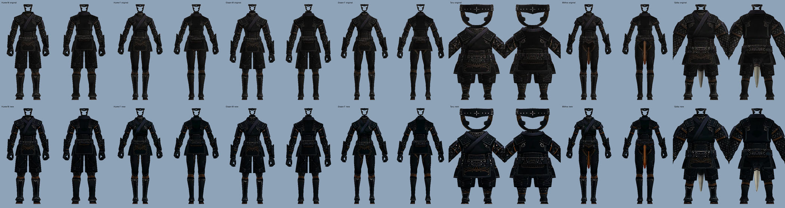

**Dragoon (Drachen)**
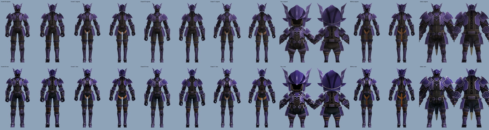

**Summoner (Evoker's)**
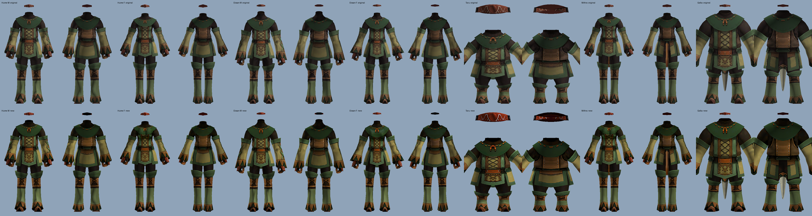

**Blue Mage (Magus)**
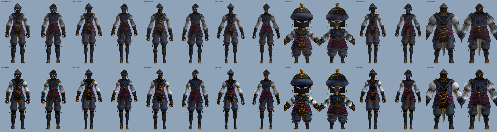

**Corsair's**
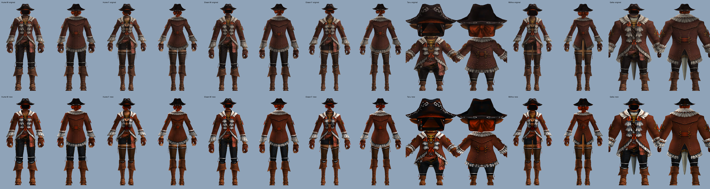

**Puppetmaster (Puppetry)**


**Dancer's**
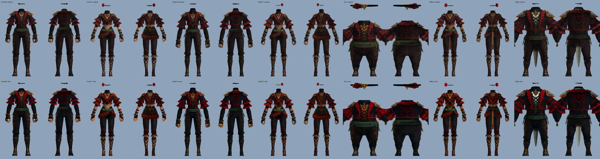

**Scholar's**
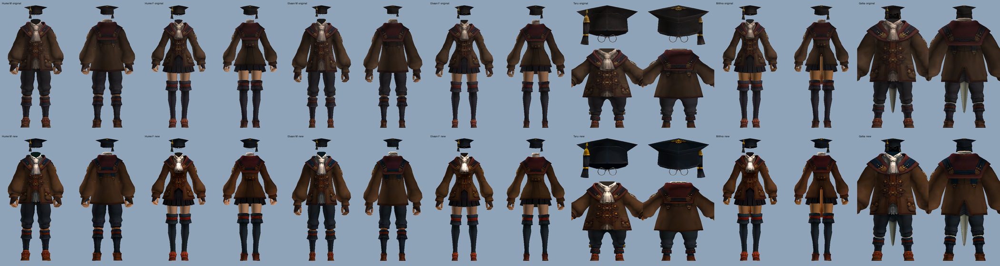

**Geomancer (Geomancy)**


**Rune Fencer (Runeist)**


**RSE, lv1 (and lv62 hands/feet)**


**RSE, lv27-33**


---

## Install

1. Copy the folder into your Pivot `DATs` folder. It sits next to `NextHD`, `XiView` and
   the rest. You end up with, for example:

   ```
   <your DATs folder>\DhalmelCow-HD\ROM\5\15.DAT
   ```

2. In game type `/pivot`, click **+** on the mod, and **drag it to the top of the list**.

3. Restart the game.

That's it.

**Why the top?** Pivot uses the first folder in the list that has the file. If NextHD is
above your mod, you see NextHD's Dhalmel. Mod on top, you see the mod.

**Want the other mod instead?** Put both in. Whichever is higher wins. Drag to swap.

**Turn it off:** uncheck it in `/pivot`, or delete the folder. Nothing else to undo.

---

## Which file do I take?

The HD mods give you NextHD's sharper textures. The retail mods give you the plain game
textures. Same cow, same neck, same animations. Only the texture resolution differs.

Take the HD one if you run any HD DAT pack. Take the retail one if you don't.
Wrong pick costs you nothing but sharpness.

---

## Build your own

[`ffxi_modder`](https://github.com/cowrevenge/ffxi_modder) makes these from any Dhalmel DAT.
The output always goes in its own folder, never into NextHD's.

```powershell
git clone https://github.com/cowrevenge/ffxi_modder
cd ffxi_modder
cargo run --release -- "<your>\ROM\5\15.DAT" --check                          # must say byte-identical
cargo run --release -- "<your>\ROM\5\15.DAT" out.DAT                          # neck
cargo run --release --bin dhalmel_cow -- "<your>\ROM\5\15.DAT" out.DAT        # cow
```

Feed it your retail `ROM\5\15.DAT` for a retail build, or NextHD's copy for an HD build.
Run `--check` first: if the writer can't reproduce your file byte for byte, don't trust a
mod built from it.

A rebuild won't be bit-identical to the files here (compiler float noise, invisible in game).
The files in this repo are the ones that were rendered and checked. Prefer them.

`ROM\5\15.DAT` is where the Dhalmel lives on this install (model 332, DAT id 1632). Your
install can map it elsewhere: see `ffxi_modder`'s README to resolve it.

---

## Files

Every DAT and its hash is in [`SHA256SUMS.txt`](SHA256SUMS.txt).

| | |
|---|---|
| retail mods | [`retail/`](retail) |
| HD mods | [`nexthd/`](nexthd) |
| untouched originals, both bases | [`original/`](original) |
| what's winning in your Pivot | `tools\verify-pivot.ps1 -DatPath ROM\5\15.DAT` |

```powershell
Get-FileHash -Algorithm SHA256 .\retail\DhalmelCow\ROM\5\15.DAT
```

---

## Legal

Everything here derives from Square Enix retail game data: the mods are that model with
sections swapped, the originals are unaltered. Shared in the same spirit as the HD DAT
overlays that already circulate in the FFXI community. The tooling is GPL-3.0 and lives in
[`ffxi_modder`](https://github.com/cowrevenge/ffxi_modder), which contains no game data.
