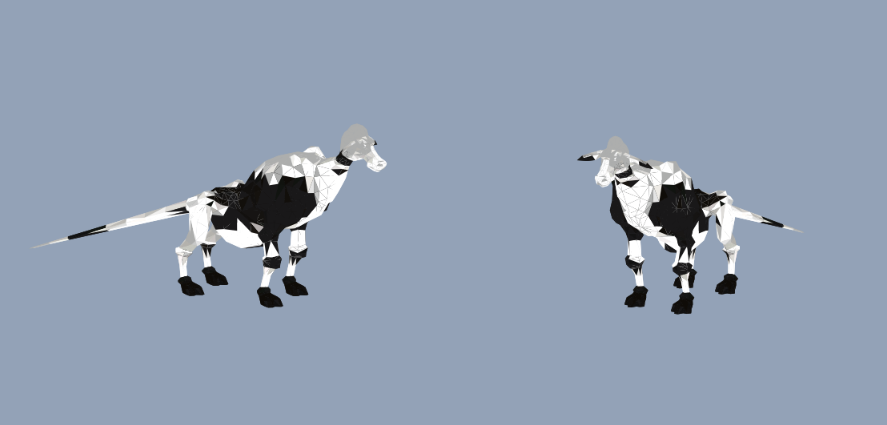

# Dhalmel Shaft

Every Dhalmel in FFXI gets its head and neck replaced with one procedural purple shaft. It
rises from the shoulder seam along the neck's own centerline and is weighted entirely onto
the neck and head bones, so it bends with the neck and nods with the head like the geometry
it replaced.

Client-side only. Nothing on disk is modified and nothing is uploaded anywhere; the mod is
one file dropped into a [XIPivot](https://github.com/HealsCodes/XIPivot) overlay, so it is
visible only on machines that install it.


---

## Repository layout

```
overlay/DhalmelShaft/ROM/5/15.DAT     the modded model                 501,024 bytes
original/ROM/5/15.DAT                 the pristine retail file          481,984 bytes
tools/verify-pivot.ps1                checks Pivot's overlay precedence
docs/images/                          screenshots and references
SHA256SUMS.txt                        integrity hashes for both DATs
```

`original/` is the untouched retail model, included so you can diff what changed and so the
mod can be rebuilt from a known-good base without depending on your install matching mine.

| file | bytes | SHA-256 |
|---|---|---|
| `overlay/DhalmelShaft/ROM/5/15.DAT` | 501,024 | `86f9a5b7c83614b49c3e7a71dd93e0143e157a2fd4b53c5c12ec46d6ff561ad3` |
| `original/ROM/5/15.DAT` | 481,984 | `6283bb7dff849da0e0eb20f04d529c2e1f2effeaf7b52be301301913540f42ec` |

Check before installing:

```powershell
Get-FileHash -Algorithm SHA256 overlay\DhalmelShaft\ROM\5\15.DAT
```

## Install

**Requires XIPivot.** Confirm it is loading with `/pivot` in game.

1. Find Pivot's overlay root. Read it from `root_path` in Pivot's config -- do not guess.
   With Ashita that is usually `polplugins/DATs`, and existing overlays sit in it directly.
2. Copy `DhalmelShaft` into that folder so the file lands at:

   ```
   <overlay root>\DhalmelShaft\ROM\5\15.DAT
   ```

3. Enable it and put it **above any overlay that also ships `ROM/5/15.DAT`**.
4. Restart the client. Pivot resolves DATs at load, so a reload is not enough.

### The ordering trap

Pivot's rule is *the lowest-numbered overlay holding the file wins*. High-res texture and
model packs commonly carry their own copy of the same DAT -- NextHD ships a 776,896-byte
high-poly Dhalmel at this exact path, for example. If `DhalmelShaft` sorts below it you see
no change at all and reasonably conclude the mod is broken.

`tools/verify-pivot.ps1` resolves the config the way Pivot does and tells you which overlay
actually wins:

```powershell
powershell -File tools\verify-pivot.ps1
```

It prints each enabled overlay and whether it contains `ROM\5\15.DAT`, names the winner,
and exits non-zero if something is shadowing the mod.

### Uninstall

Delete the `DhalmelShaft` folder from the overlay root and restart. There is nothing else to
revert -- the game files were never touched.

## Mesh preview


The added geometry in its rest pose on a flat background, before lighting and animation.
Use this rather than a screenshot to judge shape -- shaft profile, flared base, tip curve --
and to check intended colour, since it is unlit and shows the texture's raw `#9A2BD8`.

## How it is made

Built with [`ffxi_modder`](https://github.com/cowrevenge/ffxi_modder), a GPL-3.0 lossless
reader/writer for these DATs. The interesting half is that the head is identified from the
skeleton rather than by guessing which mesh section it is:

| | |
|---|---|
| **head** | joint 36 -- the skeleton's look-at reference, the bone retail bends to aim the face -- plus its 9 descendants (ears etc.) |
| **neck** | the parent chain from the head down to the first joint that branches |
| **shoulders** | joint 29, that branching parent, which also carries the front legs |

Then 273 head and neck triangles are removed, 10 neck-base triangles are retextured in place
to close the seam, and 265 vertices / 494 triangles are added in 4 draws -- every one of them
weighted 100% onto the neck and head joints, and mirrored on Z the way the head was. That is
what makes it animate correctly for free: it inherits motion because it is bound to the same
bones the head was.

Colour comes from a new 16x16 DXT3 solid-purple texture chunk appended to the DAT, not from
`t_factor`. Its header is copied from a retail texture so the fields whose meaning is unknown
keep plausible values.

Measurements of the shipped shape: shaft length 3.692, shaft radius 0.260, base radius 0.434,
24 rings.

### Rebuild it yourself

The DAT is not required -- generate it from a retail file you already own:

```powershell
git clone https://github.com/cowrevenge/ffxi_modder
cd ffxi_modder
cargo run --release -- "<your FFXI>\ROM\5\15.DAT" out.DAT
```

Verify the writer is trustworthy on your file first; an unedited parse and write should come
back byte-identical:

```powershell
cargo run --release -- "<your FFXI>\ROM\5\15.DAT" --check
```

Shape is tunable through the `const`s at the top of `src/main.rs` -- `PURPLE`,
`SHAFT_RADIUS_SCALE`, `TIP_PER_HEAD_LENGTH`, `SEAM_OVERLAP`, `GLANS`, and the rest.

Two honesty notes:

- **Rebuilds are not bit-identical to the committed file.** Re-running the tool reproduces
  the model exactly but leaves 1,708 bytes different -- 1,337 float lanes with a maximum
  absolute delta of 3.97e-05 on a model about 3.7 units tall. That is normalised-vertex
  floating-point noise from the compiler backend, invisible in game. If you want *this* file,
  download it; if you changed a `const`, rebuild.
- **`ROM\5\15.DAT` is not a universal path.** It is this install's mapping. The file id
  resolves through your own VTABLE/FTABLE, so on another client the same model can live in a
  different folder. See below.

## Finding a model's DAT file

The route used here, all from data rather than trial and error:

1. **model id 332** -- LandSandBoat `data/zones/*/mobs.yaml`; all 35 `dhalmel` entries agree.
   (Common mobs moved out of `mob_pools.sql` into per-zone YAML.)
2. **DAT file id 1632** -- `npc_dat_id()`: `model < 1500` gives `model + 1300`;
   `< 3000` gives `+ 50295`; `< 3500` gives `+ 96907`; otherwise `+ 98239`.
3. **ROM path** -- the highest ROM whose VTABLE byte equals its own index owns the file, then
   `dir = entry >> 7` and `file = entry & 0x7F`.

Step 3 is install-specific. Resolve it against your own DATs rather than trusting
`ROM\5\15.DAT`.

## Roadmap

| target | state |
|---|---|
| Dhalmel head -> purple shaft | shipped |
| Galka body -> dragon shaft | next |

Both run through the same writer, so the Galka is that code pointed at a different skeleton
rather than new capability.

## Next project



The theming reference for what comes after the Dhalmel.

## Legal

Both DATs derive from Square Enix retail game data. The modded file is the retail model with
two mesh sections swapped; the original is that same file unaltered, kept for reference and
reproducibility. Published in the same spirit as the HD DAT overlays that already circulate
freely in the FFXI community.

For tooling only, use [`ffxi_modder`](https://github.com/cowrevenge/ffxi_modder) -- it is
separate and contains no game data at all.
