<div align="center">

# Cow's FFXI Mods

**Every piece of armour in HD for every race, Bastok Pride built in, and some very real cows.**

Drop the folders into Pivot and play. The game's own files are never touched, and only you see the mods.

</div>

---

## Dhalmel Mods

Pick **one**. Both replace the same Dhalmel, so only one can show at a time.

### Real Cows!

[](https://github.com/cowrevenge/ffxi_mod_files/raw/main/downloads/Dhalmel-RealCows.7z)


<sub>No HD pack (NextHD etc.)? Take [the plain version](https://github.com/cowrevenge/ffxi_mod_files/raw/main/downloads/Dhalmel-RealCows-NoHDPack.7z) instead.</sub>

### Gag Model (Shafty)

[](https://github.com/cowrevenge/ffxi_mod_files/raw/main/downloads/Dhalmel-Shafty.7z)


<sub>No HD pack? Take [the plain version](https://github.com/cowrevenge/ffxi_mod_files/raw/main/downloads/Dhalmel-Shafty-NoHDPack.7z) instead.</sub>

---

## Bastok Pride

The Centurion set repainted in bright Bastok colours: indigo cloth, stacked polished steel,
cool leather and a brass cow emblem on the chest, with **Battle Gloves HD** and **Bounding
Boots HD** (the BLU outfit). Fuller bust on Hume F, Elvaan F and Mithra. Every race.

> **No separate download.** Bastok Pride is already inside every race download below.


<sub>Top: Bastok Pride. Bottom: with Battle Gloves HD and Bounding Boots HD.</sub>


---

## AutoHD

Every armour look in the game (head, body, hands, legs, feet) with the HD pass: each piece
keeps its own design and colours, cleaned up and brightened, 4x textures. Bare skin keeps its
natural colour, and female chests on Hume F, Elvaan F and Mithra get the fuller bust.
One download per race, and each one already includes Bastok Pride.

### Hume (male)

[](https://github.com/cowrevenge/ffxi_mod_files/raw/main/downloads/CowMods-HumeM.7z)

**Artifact armour, all 22 jobs**

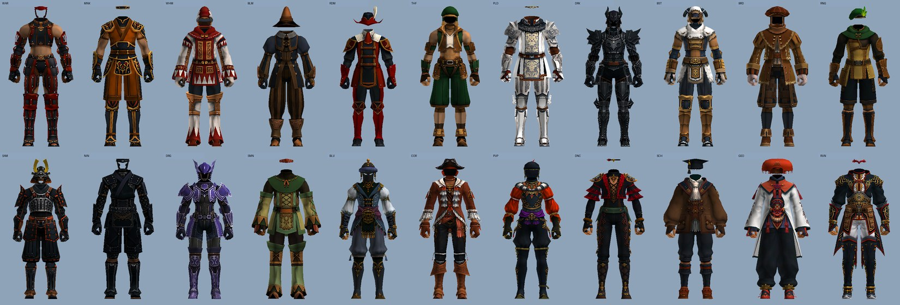

**RSE, Leather, Bone, Scale, Doublet** (original on top, new below)

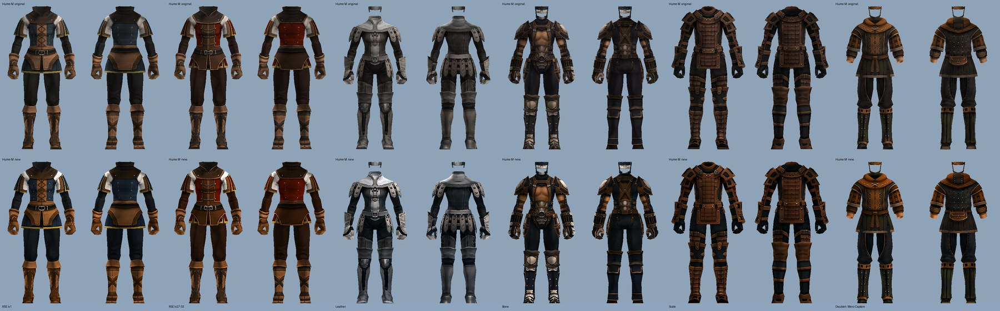

### Hume (female)

[](https://github.com/cowrevenge/ffxi_mod_files/raw/main/downloads/CowMods-HumeF.7z)

**Artifact armour, all 22 jobs**

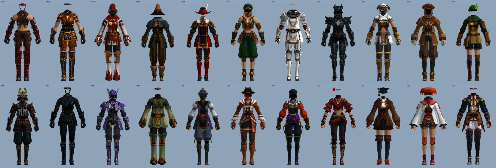

**RSE, Leather, Bone, Scale, Doublet** (original on top, new below)

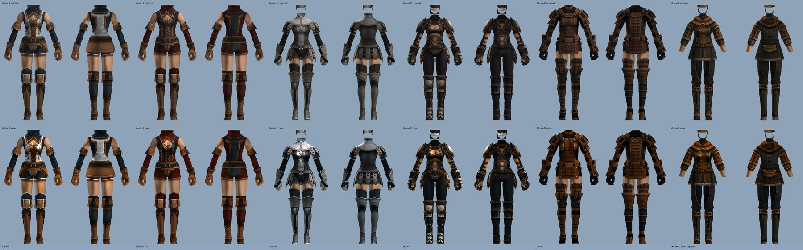

### Elvaan (male)

[](https://github.com/cowrevenge/ffxi_mod_files/raw/main/downloads/CowMods-ElvaanM.7z)

**Artifact armour, all 22 jobs**

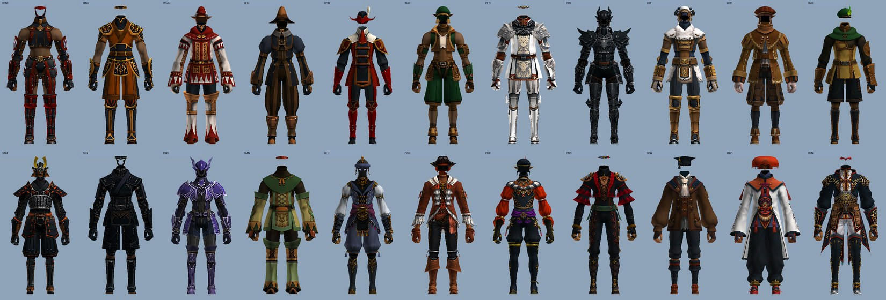

**RSE, Leather, Bone, Scale, Doublet** (original on top, new below)

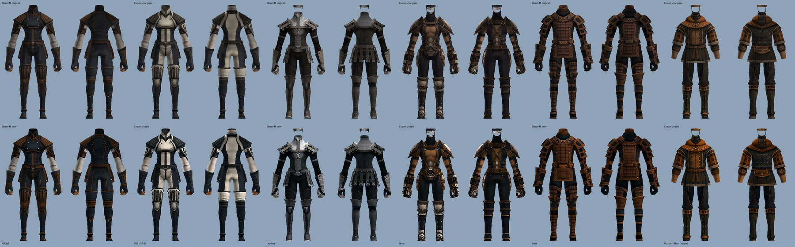

### Elvaan (female)

[](https://github.com/cowrevenge/ffxi_mod_files/raw/main/downloads/CowMods-ElvaanF.7z)

**Artifact armour, all 22 jobs**

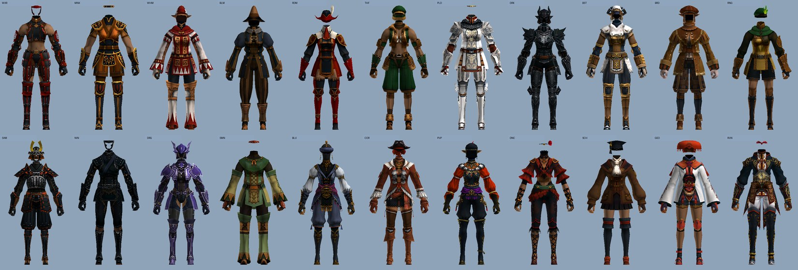

**RSE, Leather, Bone, Scale, Doublet** (original on top, new below)

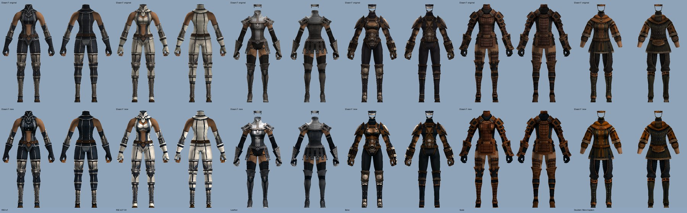

### Tarutaru (male and female)

[](https://github.com/cowrevenge/ffxi_mod_files/raw/main/downloads/CowMods-Taru.7z)

**Artifact armour, all 22 jobs**

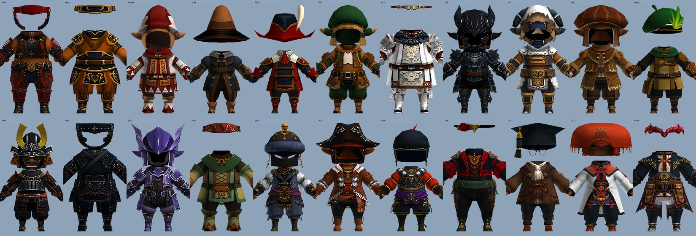

**RSE, Leather, Bone, Scale, Doublet** (original on top, new below)

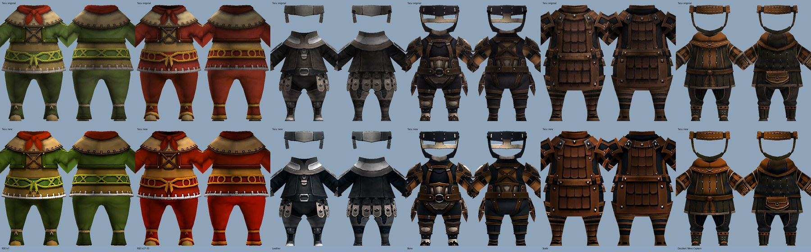

### Mithra

[](https://github.com/cowrevenge/ffxi_mod_files/raw/main/downloads/CowMods-Mithra.7z)

**Artifact armour, all 22 jobs**

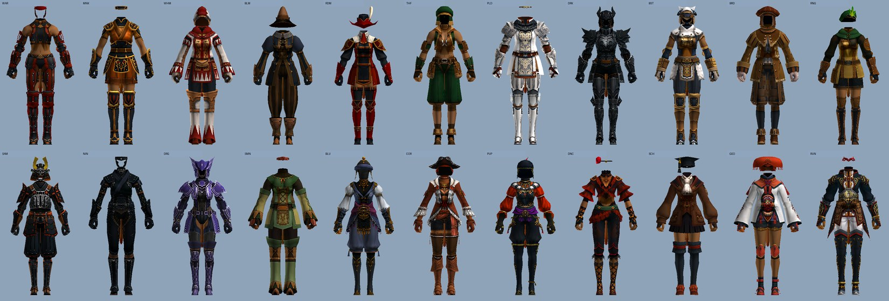

**RSE, Leather, Bone, Scale, Doublet** (original on top, new below)

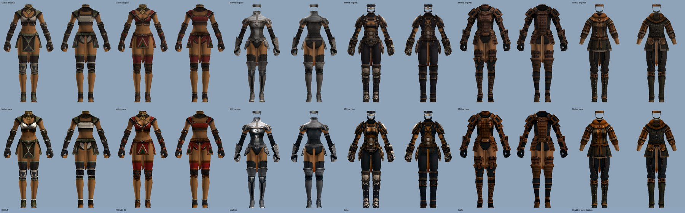

### Galka

[](https://github.com/cowrevenge/ffxi_mod_files/raw/main/downloads/CowMods-Galka.7z)

**Artifact armour, all 22 jobs**

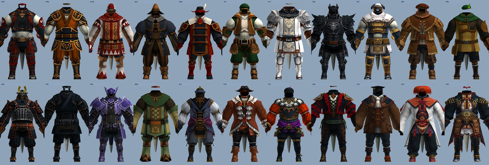

**RSE, Leather, Bone, Scale, Doublet** (original on top, new below)

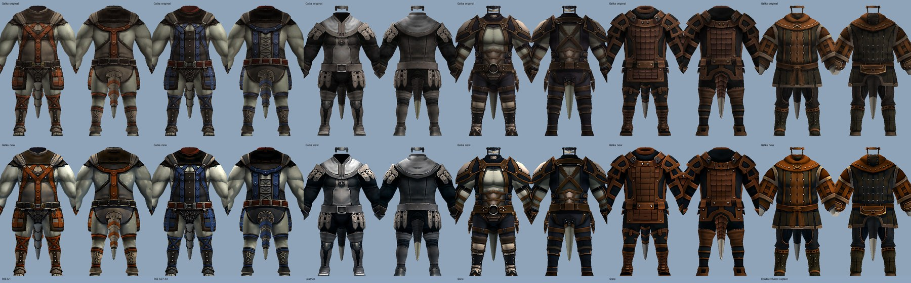

---

## Install with Pivot

1. **Download** the race downloads you want. Take every race to see everyone around you in HD,
   or just the races you play.

2. **Unzip them all into the same place.** Open each `.7z` (Windows 11 opens it directly;
   otherwise use [7-Zip](https://www.7-zip.org/)). Every one unpacks into the same `AutoHD`
   folder, so unzip them all into your Pivot `DATs` folder and let them merge:

   ```
   C:\PhoenixXI\polplugins\DATs\AutoHD\
   ```

   Add one Dhalmel mod the same way if you want it.

3. **Turn them on.** In game type `/pivot` and click **+** on each folder.

4. **Put them in order**, top to bottom (Pivot uses the first folder that has a file):

   | order | folder | why |
   |---|---|---|
   | 1 | `DhalmelCow-HD` **or** `DhalmelShaft-HD` | only one Dhalmel can show; uncheck the other |
   | 2 | `AutoHD` | all the HD gear, Bastok Pride included |
   | 3 | `NextHD` and any other HD packs | everything else |

5. **Restart the game.**

**Turn something off:** uncheck it in `/pivot`, or delete its folder. Nothing else to undo.

<sub>Made for Phoenix: the files sit where Phoenix's client keeps each item. Another
server's client can map items to other files.</sub>

---

## Behind the mods

- Tools: [`ffxi_modder`](https://github.com/cowrevenge/ffxi_modder) (GPL-3.0, no game data).
- Every mod's files, one folder per mod: [`retail/`](retail) and [`nexthd/`](nexthd), with hashes in [`SHA256SUMS.txt`](SHA256SUMS.txt).
- Untouched originals: [`original/`](original).

<sub>Everything here is derived from Square Enix retail game data and shared in the same
spirit as the HD DAT overlays that already circulate in the FFXI community.</sub>
