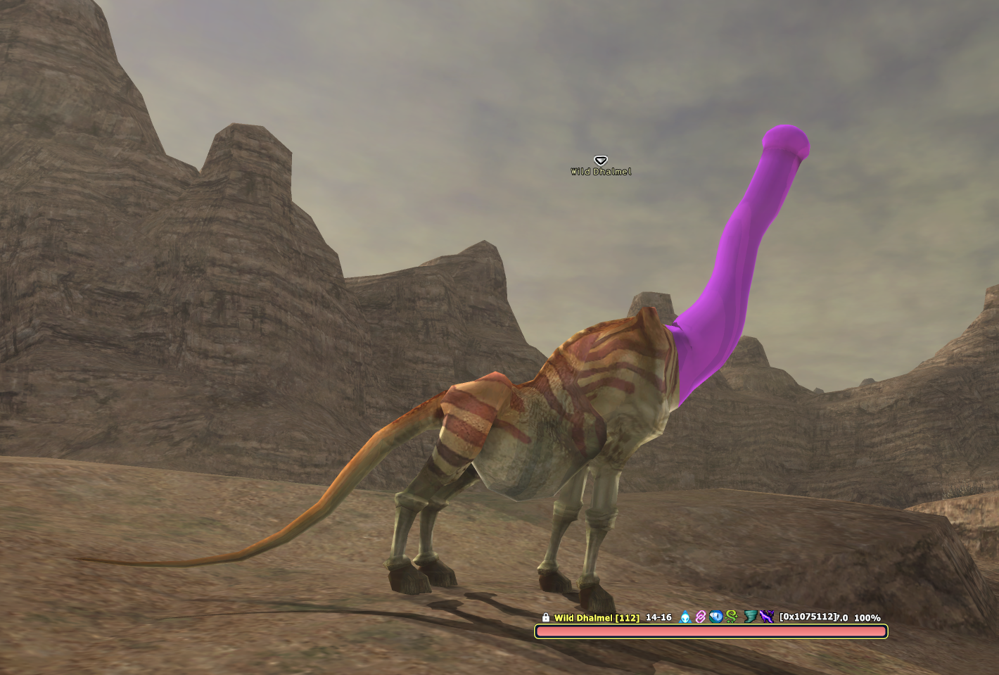

# ffxi_mod_files

Repository of built client-side FFXI DAT mods. Each mod is a single replacement `.DAT` that
drops into a [XIPivot](https://github.com/HealsCodes/XIPivot) overlay root -- nothing is
written to the game files and nothing is served to anyone else, so a mod is visible only on
machines that install it.



The tooling that produces these files lives separately in
[`ffxi_modder`](https://github.com/cowrevenge/ffxi_modder) (GPL-3.0). This repo is the output;
that one is the source.

---

## Mod list

| mod | target | status | overlay folder | file |
|---|---|---|---|---|
| **Dhalmel Neck** | Dhalmel neck and head | shipped | `DhalmelShaft` | `ROM/5/15.DAT` |
| **Dhalmel Cow** | Dhalmel -> cow | in progress | - | - |

Everything under `overlay/` mirrors Pivot's overlay root one-to-one. Copy the contents of
`overlay/` into your `DATs` folder and every shipped mod lands in place. A new mod is a new
sibling folder, not a restructuring.

## Using these files

### Requirements

**XIPivot**, confirmed loading with `/pivot` in game.

### Install

1. Find Pivot's overlay root by reading `root_path` from Pivot's config -- do not guess it.
   Under Ashita it is usually `polplugins/DATs`, with existing overlays sitting directly in it.
2. Copy the mod's folder out of `overlay/` into that root, keeping its `ROM\...` path intact.
3. Enable the mod and place it **above any overlay that ships the same DAT path**.
4. Restart the client. Pivot resolves DATs at load, so a reload is not enough.

### Overlays and ordering

Pivot's rule is *the lowest-numbered overlay holding the file wins*. HD texture and model
packs routinely carry their own copy of the same DAT -- NextHD ships a 776,896-byte high-poly
Dhalmel at `ROM/5/15.DAT`, for example. If your mod sorts below one of those you see no change
at all and reasonably conclude it is broken.

`tools/verify-pivot.ps1` resolves the config the way Pivot does, prints every enabled overlay
and whether it contains the file, names the winner, and exits non-zero when something is
shadowing the mod:

```powershell
powershell -File tools\verify-pivot.ps1
```

### Uninstall

Delete the mod's folder from the overlay root and restart. There is nothing else to revert --
the game files are never touched.

---

## Dhalmel Neck

*Shipped.* Replaces every Dhalmel's head and neck with one procedural purple shaft. It rises
from the shoulder seam along the neck's own centerline and is weighted entirely onto the neck
and head joints, so it bends with the neck and nods with the head the way the geometry it
replaced did.

| file | bytes | SHA-256 |
|---|---|---|
| `overlay/DhalmelShaft/ROM/5/15.DAT` | 501,024 | `86f9a5b7c83614b49c3e7a71dd93e0143e157a2fd4b53c5c12ec46d6ff561ad3` |
| `original/ROM/5/15.DAT` | 481,984 | `6283bb7dff849da0e0eb20f04d529c2e1f2effeaf7b52be301301913540f42ec` |

`original/` is the untouched retail Dhalmel the mod was built from, kept so the diff can be
verified and so the mod can be rebuilt from a known-good base without your install matching
mine. Check either file before trusting it:

```powershell
Get-FileHash -Algorithm SHA256 overlay\DhalmelShaft\ROM\5\15.DAT
```

### The mesh


The added geometry in its rest pose, before lighting and animation. Use this rather than a
screenshot to judge shape -- shaft profile, flared base, tip curve -- and to check intended
colour, since it is unlit and shows the texture's raw `#9A2BD8`.

Target bones were read from the skeleton rather than guessed from mesh section order:

| | |
|---|---|
| **head** | joint 36, the skeleton's look-at reference -- the bone retail bends to aim the face -- plus its 9 descendants (ears etc.) |
| **neck** | the parent chain from the head down to the first joint that branches |
| **shoulders** | joint 29, that branching parent, which also carries the front legs |

From there, 273 head and neck triangles are removed, 10 neck-base triangles are retextured in
place to close the seam, and 265 vertices / 494 triangles are added in 4 draws. Every added
vertex is weighted 100% onto the neck and head joints and mirrored on Z the way the original
head was -- which is why the shaft animates for free: it is bound to the bones the head used.

Colour is a new 16x16 DXT3 solid-purple texture chunk appended to the DAT, not a `t_factor`
tint. Its header is copied from a retail texture so fields of unknown meaning keep plausible
values. First texel reads back `[156, 40, 222, 136]`.

Shipped dimensions: shaft length 3.692, shaft radius 0.260, base radius 0.434, 24 rings.

### Rebuild

The committed DAT is not required. Generate it from a retail file you own:

```powershell
git clone https://github.com/cowrevenge/ffxi_modder
cd ffxi_modder
cargo run --release -- "<your FFXI>\ROM\5\15.DAT" out.DAT
```

Prove the writer is trustworthy on your file first -- an unedited parse and write must return
byte-identical:

```powershell
cargo run --release -- "<your FFXI>\ROM\5\15.DAT" --check
```

Shape is tunable through the `const`s at the top of `src/main.rs`: `PURPLE`,
`SHAFT_RADIUS_SCALE`, `TIP_PER_HEAD_LENGTH`, `SEAM_OVERLAP`, `GLANS`, and the rest.

Two things worth knowing before you do:

- **A rebuild will not be bit-identical to the committed file.** Re-running the tool reproduces
  the model exactly but leaves 1,708 bytes different -- 1,337 float lanes, maximum absolute
  delta 3.97e-05 on a model about 3.7 units tall. Compiler floating-point noise in the
  normalised vertices, invisible in game. Want *this* file, download it; changed a `const`,
  rebuild.
- **`ROM\5\15.DAT` is this install's mapping, not a universal one.** See
  [Resolving a model to a DAT path](#resolving-a-model-to-a-dat-path).

## Dhalmel Cow

*In progress.* Rebuild the Dhalmel along the cow reference below. Not shipped yet -- the model
id, DAT path, skeleton and target sections still have to be worked out the way the neck mod's
were, then the geometry produced with `ffxi_modder`.


Both mods run through one code path: resolve the model, read its skeleton, measure the target
bones, delete their triangles, add procedural geometry bound 100% to those bones.

---

## Repository layout

```
overlay/<ModName>/ROM/<dir>/<file>.DAT   the mod, ready to drop into Pivot's overlay root
original/ROM/<dir>/<file>.DAT            the retail file a mod was built from
tools/verify-pivot.ps1                   resolves Pivot config, checks overlay precedence
docs/images/                             in-game shots, mesh previews, references
SHA256SUMS.txt                           integrity hashes for every DAT
README.md
```

Adding a mod means: a new folder under `overlay/`, its retail original under `original/`, a
row in the mod list, a section here, and a line in `SHA256SUMS.txt`.

## Tooling

[`ffxi_modder`](https://github.com/cowrevenge/ffxi_modder) is a GPL-3.0 lossless reader and
writer for these DATs. The property that makes this workflow safe is that an unedited parse and
write reproduces the input byte-for-byte -- so anything a mod does not touch cannot drift. That
includes the 4 padding bytes retail leaves dirty after the vertex data, which a naive writer
would zero and silently change.

## Resolving a model to a DAT path

Worked out from data rather than trial and error, and the route for every mod here:

1. **model id** -- LandSandBoat `data/zones/*/mobs.yaml`, from entries sharing a species and
   skill list. (Common mobs moved out of `mob_pools.sql` into per-zone YAML.)
2. **DAT file id** -- `npc_dat_id()`: `model < 1500` gives `model + 1300`; `< 3000` gives
   `+ 50295`; `< 3500` gives `+ 96907`; otherwise `+ 98239`.
3. **ROM path** -- the highest ROM whose VTABLE byte equals its own index owns the file, then
   `dir = entry >> 7` and `file = entry & 0x7F`.

The neck mod's committed file was reached as model **332** -> file id **1632** ->
`ROM\5\15.DAT` on this install. Step 3 is install-specific, so resolve it against your own
DATs before assuming a path.

## Legal

Every DAT here derives from Square Enix retail game data. A modded file is the retail model
with mesh sections swapped; originals are those files unaltered, kept for reproducibility.
Published in the same spirit as the HD DAT overlays that already circulate freely in the FFXI
community.

For the tooling alone, use [`ffxi_modder`](https://github.com/cowrevenge/ffxi_modder) --
separate repo, GPL-3.0, no game data in it.
